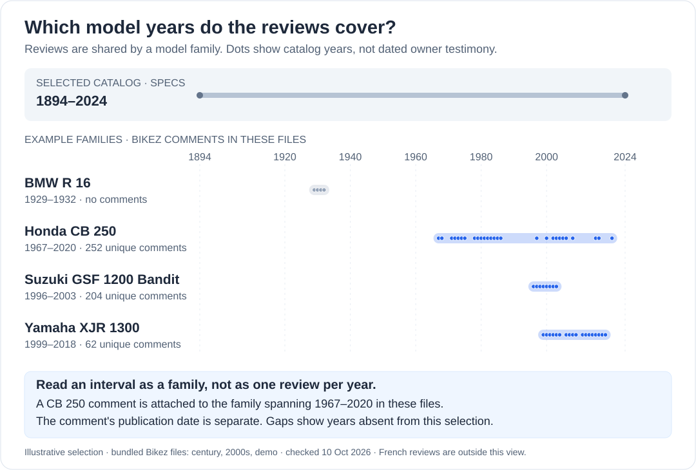

# Bikefinder RAG

An entirely local **proof of concept** for a technical motorcycle catalog
by model year. Ollama queries PostgreSQL through structured tools. Ask for
a specific sheet or a same-year comparison, in French or English — for example
*"Compare the Suzuki GSF 1200 N Bandit and Kawasaki ER-5 Twister in 2000,
with units, sources and missing data."* The existing owner-review corpus and
its retrieval code are retained for a later, separately evaluated extension.

This is a learning project and portfolio piece. The default chat path needs
no cloud account or API key. Installation and the first model downloads need
Internet; inference can run offline once the models and database are ready.
Anthropic/OpenRouter and a remote evaluation judge remain optional experiments.


## Launch video

https://github.com/user-attachments/assets/f4d35ffb-202e-4aa6-af69-7467d7dc9862

## Why this exists

A first RAG project meant to actually learn the mechanics (local embeddings,
hand-written pgvector similarity SQL, an explicit tool-use loop) rather than
wrap a framework. The repository keeps the implementation and evaluation
reports alongside the data — the short version:

- **Corpus**: self-scraped from [bikez.com](https://bikez.com) (specs + owner
  discussion forums), not a pre-packaged Kaggle dump — see [Data source](#data-source--why-self-scrape).
  The recorded full-catalog runs cover **32,395 motorcycles (1894–2024)
  and 4,335 model families**. Review counts vary with the sources loaded;
  a result belongs to its corpus snapshot, not every installation. The
  century, 2000–2023 and 2024 datasets ship in `data/`.
- **Category filter**: `Scooter` is excluded *unless* displacement ≥ 500cc
  (keeps crossovers like the Honda X-ADV or Yamaha TMAX, drops twist-and-go
  commuters), `ATV` is always excluded, everything else — including
  `Minibike` and oddball `Prototype/concept model` entries — is kept.
- **No pre-curated "top N" popular models list.** Every scraped page's forum
  is checked; a motorcycle only gets a narrative/review layer if it has ≥3
  substantive comments. The narrative subset emerges from what actually has
  discussion, not from a guessed popularity ranking.
- **Explicit technical tool-use loop** — Ollama by default, optional
  cloud backends, no orchestration framework. Two tools by default:
  `filter_specs` (typed parameters only, parameterized SQL, the LLM never
  writes SQL — plus a `count_only` mode for "how many" questions),
  and `get_bike_details` (one model's original technical sheets for an
  explicit year, with source URLs and original labels/units). Reviews are
  blocked in this path; price, A2 eligibility and family recall context are
  also outside the default tools. Legacy review retrieval remains available
  to Python callers through an explicit opt-in.
- **PostgreSQL + pgvector**, one database for both structured specs and
  review embeddings.
- **Comments belong to model families, not model-years.** bikez.com shares
  one discussion forum across every year and variant of a model (the same
  threads back the CB 250 K 1 1970 and the CB 250 N 1985), so comments are
  stored once per family (`model_families`), deduplicated, and every
  retrieval result carries the family's year range plus the comment's own
  post date — the agent is instructed never to attribute a comment to one
  specific model-year.
- **Local, multilingual embeddings** (`BAAI/bge-m3`) — no embeddings API key
  needed. The review corpus is **bilingual since 2026-09-02**: bikez.com forum
  comments (English, `lang='en'`) and motoplanete.com owner reviews (French,
  `lang='fr'`, with a /5 `rating`) share one table and one embedding space, so a
  French question reaches both; the sparse leg runs an English *and* a French
  tsquery, and the agent is asked to phrase `query` in the user's language.
- **Evaluation**: four layers, with historical results and their limitations.
  [`scripts/eval_retrieval.py`](scripts/eval_retrieval.py) checks the
  retrieval layer alone, no LLM involved (data integrity, self-retrieval,
  keyword-based theme proxies and off-topic distance controls — see
  [`eval_results/retrieval/`](eval_results/retrieval/)).
  [`scripts/eval_tool_trajectory.py`](scripts/eval_tool_trajectory.py)
  scores how a model calls the tools — deterministic predicates over the
  recorded calls, no LLM judge; its findings drove the few-shot prompt,
  the Ollama options and the visible argument repair, taking mistral-small
  from 9/12 to 15/15 golden questions
  ([`eval_results/trajectory/`](eval_results/trajectory/)).
  [`scripts/eval_constraints.py`](scripts/eval_constraints.py) then checks
  the final answers themselves: every motorcycle named in a reply is
  resolved against the database and verified against the question's hard
  constraints — a historical run reported **0.0% detected violations**
  over 41 resolved mentions. The legacy checker could treat missing numeric
  data as satisfied; this is not evidence that every constraint was verified
  ([`eval_results/constraints/`](eval_results/constraints/)).
  [RAGAS](https://github.com/explodinggpt/ragas)
  (faithfulness, answer relevancy) then scores the full agent over the
  golden set: a historical run reports **0.76 / 0.87** (local generation
  mistral-small3.2, **remote** judge Haiku via `claude -p`, 17 questions;
  answer relevancy is available for 16). The published fully local run
  reports **0.61 / 0.76 on 12 questions** with a qwen3.6 judge. These runs
  have different configurations and do not establish a controlled gain.
  An earlier two-judge pass (qwen3.6 local
  + Haiku) converged per-question, caught two real retrieval bugs whose
  fixes lifted narratives from 0.0 to 1.0, and documented RAGAS's known
  penalty on honest "no data on record" refusals
  ([`eval_results/ragas/`](eval_results/ragas/)).
- **Interface**: Gradio on `127.0.0.1`, using the local Ollama model by
  default. The optional cloud interface asks for the visitor's own key.
  The Hugging Face deployment directory is a historical showcase experiment.

The first technical slice offers **sheets and simple comparisons by model
year**, with owner reviews deferred. Its [validation record](docs/technical-catalog-first-slice.md)
separates real SQL checks, simulated model transport and the pending live
generation check. The [refactor issue](https://github.com/maax6/bikefinder-rag/issues/2)
and [local plan](docs/technical-catalog-refactor.md) cover the remaining
identity/measure corrections, equipment/colors and model evaluation for an
M5 with 32 GB. Normalized weights still mix dry and wet values; use the original
labels, and do not derive a power/weight ranking from these legacy columns.

## Which model years do the reviews cover?



Each dot is a **model year present in the three selected datasets**:
`data/century`, `data/2000s` and `data/demo`, checked on 2026-10-10. The
interval joins the earliest and latest years of a family; gaps between
dots are gaps in this selection, not necessarily in other bundled datasets
or the database. The comment counts are deduplicated Bikez comments from
these same files.

For example, Honda CB 250 entries span **1967–2020** in these files. Their
comments form one shared family pool: that range does **not** establish
owner testimony for every year or generation. A comment's publication date
(`posted_at`) is separate from the family's model-year range
(`family_year_min` / `family_year_max`).

This is an illustrative selection, not the full review inventory. French
Motoplanete reviews also join model families in the local database; they
are outside this figure. Coverage depends on the datasets loaded locally.

## Data source & why self-scrape

There's an existing Kaggle dataset (`all_bikez`, CC0) scraped from bikez.com
in 2022. We scrape ourselves instead: it keeps specs *and* forum comments on
one unified pipeline, it's current rather than frozen at 2022, and it directly
extends [github.com/maax6/Bikefinder](https://github.com/maax6/Bikefinder),
which this project grew out of.

`robots.txt` on bikez.com disallows specific interactive endpoints (rating,
review submission, spec-update forms) for all crawlers, not the spec or
discussion pages themselves — a sitemap is published for exactly this kind
of discovery. The scraper (`src/bikefinder_rag/scraper/`) respects that,
identifies itself with a real User-Agent, and enforces a fixed delay between
every request (`SCRAPER_DELAY_SECONDS`, default 1.5s).

## ⚠️ Known limitation: price data

**bikez.com has no price field at all** (verified against both the 2022
Kaggle dataset's validation report and a live fetch of a well-documented,
recent model — 0% coverage either way). Price was judged important enough
to the project's original intent (this started life as "Bikefinder" — find
a motorcycle to *buy*) to be worth a second source, but the obvious French
marketplaces block that outright:

| Site | Result |
|---|---|
| Leboncoin | `robots.txt`: *"forbidden to use search robots... access only with special permission"* |
| La Centrale | DataDome anti-bot (CAPTCHA-gated) |
| ParuVendu | `robots.txt` disallows exactly the `/auto-moto/*` paths |
| **Motoplanete** | ✅ **viable** (verified 2026-07-12): `robots.txt` allows the spec pages and publishes a moto sitemap (~12k pages); CGU has no database-extraction clause (non-commercial use only); fiches carry French MSRP ("Tarifs France"), full specs *and* explicit A2-version info. Hard constraint: `Crawl-delay: 10` → targeted enrichment of our existing models, not a catalog clone. |
| **Motoplanete — owner reviews** | ✅ **viable, same terms** (re-checked 2026-09-02): every fiche carries an "Avis des motards" block — owner reviews written in French with a /5 rating, the reviewer's model year and a date, server-rendered (no AJAX), pooled per model rather than per model-year. Crawled one fiche per (brand, model) at the site's `Crawl-delay: 10` — see [`scripts/scrape_motoplanete_reviews.py`](scripts/scrape_motoplanete_reviews.py). |
| Moto-Station (Maxitests) | Owner-written long-form tests, `robots.txt` open to generic agents — **but** it disallows the whole site to every named AI crawler (GPTBot, ClaudeBot, anthropic-ai, CCBot…). A RAG *is* that use, whatever User-Agent string we send — dropped. |
| Le Parking Moto | `robots.txt` permissive, **but** CGU (checked 2026-07-16) explicitly forbid robots/spiders and any reuse "à des fins commerciales ou non" without express authorization — dropped; asking for authorization remains possible. |
| AutoScout24 | search pages (`/lst-moto?`), GraphQL APIs and AI crawlers all disallowed, no offer sitemap — no clean discovery path. The 2022 used-price snapshot in `data/` is a ZenRows *sample* of this site, used as a dated cote only. |

We don't scrape against an explicit prohibition or bypass anti-bot protection
(Le Repaire des Motards was probed for French owner reviews and serves an
active human-check page to automated clients — dropped, whatever its
robots.txt says).

**Historical enrichment run** —
`scripts/scrape_motoplanete_prices.py` collected 11,418 fiches (93% with a
French launch price, 100% with a curated category), and
`scripts/load_motoplanete_prices.py` matched 9,390 of them (82%) onto our
motorcycles: **7,137 bikes carried a French MSRP** in `msrp_eur` (22% of
the catalog, 25-29% of each decade since 1990) and
7,356 a clean `category_fr` (Roadster, Sportive, Trail, Supermotard...) —
used as a cross-check against bikez's loose categories, which mislabel
e.g. recent Transalps as 'Super motard'. Coverage is still partial, and
the agent is instructed to say "no price data" plainly rather than imply a
bike is unaffordable or doesn't exist. These coverage figures precede the
October 2026 matching correction: the old fallback could confuse numeric
model identifiers (for example CBF500 and CBF600N). Corrected code prevents
those matches on future imports; existing enrichments need a separate audit
and rebuild before their coverage or correctness is re-published.

A read-only replay of 11,416 plausible fiches with the revised matcher
reduced automatic matches from 9,390 to 6,821. All 346 previously identified
priced cases with disjoint numeric identifiers lose that contradiction;
this is a diagnostic proxy, not a human validation of every new match.
The conservative rule deliberately leaves more ambiguous names unmatched.

Two more data layers ride along (loaded by their own idempotent scripts):

- **US safety recalls** (`scripts/load_nhtsa_recalls.py`): NHTSA's free
  flat files, 3,521 campaign rows matched onto 431 model families — the
  project's only *objective* reliability signal, surfaced by
  `get_bike_details` with an explicit "US market only" caveat.
- **Indicative used prices** (`scripts/load_used_prices.py`): median and
  quartiles per (family, registration year) aggregated from a 2022
  European marketplace snapshot (Kaggle, ~18k deduplicated listings, 598
  families) — a dated cote indicative, presented as such, never as
  today's market value.

## Architecture

```
Local Gradio UI (127.0.0.1, no API key)
        │
        ▼
Agent loop (Ollama by default, explicit tool-use)
        │
        ├── filter_specs ────► PostgreSQL (typed columns, parameterized SQL)
        │
        └── get_bike_details ► PostgreSQL (explicit model year, original
                                technical specs and source URL)
```

The retained review pipeline uses pgvector, BGE-M3 and a local reranker;
default technical queries on the loaded catalog do not import or load those
models. The existing dataset loader still processes comments.

## Project layout

```
src/bikefinder_rag/
  scraper/        list_scraper.py, detail_scraper.py, categories.py, http.py
  db/             schema.sql, client.py
  embeddings/     embedder.py (BGE-M3)
  agent/          tools.py, loop.py
  eval/           golden_questions.json, run_ragas.py
  app.py          Gradio interface
scripts/
  run_pilot_scrape.py            stratified sample (categories x decades x brands)
  load_db.py                     loads scraped JSONL into Postgres, embeds comments
  scrape_motoplanete_prices.py   French prices + categories (11.4k fiches)
  scrape_motoplanete_reviews.py  French owner reviews, one fiche per model (3.7k fiches)
  load_motoplanete_prices.py     matches fiches onto motorcycles (msrp_eur, category_fr)
  load_nhtsa_recalls.py          US safety recalls onto model families
  load_used_prices.py            2022 used-price aggregates onto model families
  load_motoplanete_reviews.py    French owner reviews onto model families (lang='fr', rating)
  eval_retrieval.py              layer-1 eval (retrieval alone, no LLM)
  eval_tool_trajectory.py        layer-1.5 eval (tool calls, no LLM judge)
```

## Running it locally

Prerequisites: Python 3.11+, a running Docker engine with Compose, and Ollama.
Start with the pilot corpus; loading the entire catalog is optional and much
more expensive. The examples below explicitly select the local backend even
if an existing `.env` still selects a cloud provider.

```bash
python3.11 -m venv .venv
.venv/bin/python -m pip install -e '.[dev]'
test -f .env || cp .env.example .env
export AGENT_BACKEND=ollama

# Start Ollama in another terminal with `ollama serve` if it is not running.
# The first pull needs Internet and enough disk/RAM for the chosen model.
ollama pull mistral-small3.2
docker compose up -d --wait postgres

# Minimal demo: the pilot data ships with the repo. The first embedding
# operation downloads BGE-M3; the first review search downloads the reranker.
PYTHONPATH=src .venv/bin/python scripts/load_db.py data/pilot

# Chat in the browser (http://127.0.0.1:7860), or use scripts/chat_cli.py.
PYTHONPATH=src .venv/bin/python src/bikefinder_rag/app.py
```

Local model loading and generation can take several minutes. Ollama has a
**180-second cooperative budget per user turn** (`OLLAMA_TURN_TIMEOUT_SECONDS`)
and a **300-second read timeout cap per request** (`OLLAMA_TIMEOUT_SECONDS`).
Each request uses the smaller of its cap and the remaining turn budget;
successive tool calls do not restart that budget. Set positive finite values
in `.env` to adjust either limit.

The budget is checked before requests and tools and after each operation.
An in-progress DB/CPU tool is not interrupted, so it can overrun the budget;
HTTP read timeouts also do not guarantee a hard wall-clock deadline. Once
exhaustion is detected, no further operation starts. Budget exhaustion,
slow-response read timeouts and connection failures have separate messages.
These settings do not change the cloud backends' timeouts.

Failed local attempts remain visible in the chat, but their incomplete tool
traces are excluded from the model's conversation state. A standalone `retry`
or `réessaie` repeats the most recent substantive question; successful tool
turns keep their evidence for follow-up questions.

Compose persists PostgreSQL in a named volume and only exposes its port on
`127.0.0.1`. Its initialization SQL runs once for a new volume. To apply the
current idempotent schema to an existing Compose database:

```bash
docker compose exec -T postgres sh -c 'psql -v ON_ERROR_STOP=1 -U "$POSTGRES_USER" -d "$POSTGRES_DB"' \
  < src/bikefinder_rag/db/schema.sql
```

For an offline session, prepare **both** local Hugging Face models once while
online, then set `HF_HUB_OFFLINE=1` in `.env`:

```bash
PYTHONPATH=src .venv/bin/python -c 'from bikefinder_rag.embeddings.embedder import embed_text; from bikefinder_rag.embeddings.reranker import rerank; embed_text("motorcycle"); rerank("motorcycle", ["owner review"])'
```

Ollama's model must also have been pulled. The scraper and the optional
NHTSA/Kaggle loaders still need Internet; they are separate preparation
steps. `RERANKER_ENABLED=0` skips the second model at a ranking-quality cost.

Optional full-catalog imports and enrichments:

```bash
# Same AGENT_BACKEND=ollama setting as above. Full embedding is costly,
# including on repeat imports: existing rows are skipped only after encoding.
PYTHONPATH=src .venv/bin/python scripts/load_db.py data/demo
PYTHONPATH=src .venv/bin/python scripts/load_db.py data/century
PYTHONPATH=src .venv/bin/python scripts/load_db.py data/2000s

# Optional enrichment layers, after load_db:
PYTHONPATH=src .venv/bin/python scripts/load_motoplanete_prices.py  # French MSRP + category_fr
PYTHONPATH=src .venv/bin/python scripts/load_nhtsa_recalls.py       # US safety recalls
PYTHONPATH=src .venv/bin/python scripts/load_used_prices.py         # 2022 used-price cote
PYTHONPATH=src .venv/bin/python scripts/load_motoplanete_reviews.py  # French owner reviews (lang='fr')
# The French reviews file is required for the last command; crawl it first
# with scripts/scrape_motoplanete_reviews.py if it is absent in your checkout.

# Re-scrape / extend (resumable at bike, thread and forum level):
PYTHONPATH=src .venv/bin/python scripts/run_demo_scrape.py \
    --years 2000-2023 --brands all --out data/2000s
```

## Evaluating

```bash
# Layer 1 — retrieval alone, no LLM (writes a dated report under eval_results/retrieval/):
PYTHONPATH=src .venv/bin/python scripts/eval_retrieval.py

# Layer 1.5 — tool-call trajectories, deterministic checks, no LLM judge
# (one model per run; writes a dated report under eval_results/trajectory/):
AGENT_BACKEND=ollama OLLAMA_MODEL=mistral-small3.2 EMBEDDER_DEVICE=cpu \
  PYTHONPATH=src .venv/bin/python scripts/eval_tool_trajectory.py

# Layer 1.75 — hard-constraint violation rate of the final answers
# (writes a dated report under eval_results/constraints/):
AGENT_BACKEND=ollama OLLAMA_MODEL=mistral-small3.2 EMBEDDER_DEVICE=cpu \
  PYTHONPATH=src .venv/bin/python scripts/eval_constraints.py

# Layer 2 — fully local RAGAS: pull the judge before running this command.
# Generation and judge are deliberately different local models.
OLLAMA_MODEL=mistral-small3.2 RAGAS_JUDGE_MODEL=qwen3.6 \
  EMBEDDER_DEVICE=cpu AGENT_BACKEND=ollama \
  PYTHONPATH=src .venv/bin/python -m bikefinder_rag.eval.run_ragas

# Data-coverage dashboard (self-contained HTML, spot what to fill next):
PYTHONPATH=src .venv/bin/python scripts/coverage_dashboard.py

# Regression tests (no database, model download or LLM call):
.venv/bin/python -m pytest -q
```

Use `RAGAS_JUDGE_MODEL=claude-cli:haiku` only for an explicitly **remote**
judge experiment. A subscription without an API key still uses a cloud model.
RAGAS can resume cached answers only when the generation identity and corpus
match; `--regenerate` explicitly discards incompatible answers. Changing the
judge alone permits re-scoring the same generated answers.

Cache verification requires the database and the generator's Ollama server
even when re-scoring answers: their identities are checked before reuse.

New evaluation reports include run provenance. Historical JSON files are
preserved as recorded; they are not a fresh validation of the current code.
Self-retrieval is a plumbing check, theme regexes are relevance proxies, and
off-topic distance controls do not implement an abstention policy. See
[`eval_results/README.md`](eval_results/README.md) before quoting a score.

## Data licensing

The **code** is MIT-licensed (see [LICENSE](LICENSE)). The **datasets in
`data/`** are compilations of third-party sources and keep their sources'
terms:

- `data/pilot`, `data/demo`, `data/century`, `data/2000s` — scraped from
  bikez.com (specs and public forum comments; their robots.txt permits the
  crawled pages, see [Data source](#data-source--why-self-scrape)).
- `data/motoplanete` — prices and categories from motoplanete.com, whose
  CGU allow **non-commercial use only**: do not reuse this data
  commercially.
- NHTSA recalls (downloaded at load time, not committed) — US public
  domain government data.
- The 2022 used-listings snapshot (fetched from Kaggle at load time, not
  committed) — ZenRows' free sample; only aggregates are stored in the
  database.

## Roadmap

1. Price enrichment and `category_fr` are implemented; audit and rebuild
   existing enrichments after the numeric matching correction before
   publishing refreshed coverage. The **"permis A2" filter** is derived from the
   specs already in base (<=35 kW and <=0.2 kW/kg direct, <=70 kW
   restrictable): `filter_specs(a2_only=true)`. Results carry an `a2` column
   saying 'A2' or 'A2 bridable'. This is a specification-based estimate;
   availability of an approved restriction kit is not verified, and the
   source mixes wet and dry weights.
2. ~~Scale scraping beyond the 2024 demo year~~ **done** (century +
   2000-2023 crawls: 32,395 bikes in the recorded full-catalog runs)
3. Shared entity resolution across sources is implemented
   (`src/bikefinder_rag/matching.py`): one token-level matcher shared by
   the enrichment loaders; the used-price cote now reaches families
   through concrete model-year rows instead of family names. October 2026
   regressions protect numeric model identifiers; ambiguous matches still
   need source-specific auditing.
4. RAGAS `context_precision`/`context_recall` (needs a hand-curated
   ground-truth set, deferred — faithfulness/answer_relevancy don't need one)
5. **Cross-lingual retrieval — shipped, and measured on the shipped path
   (2026-08-31).** `search_reviews` is three-stage: dense HNSW shortlist +
   English/French full-text shortlists (GIN, websearch with OR fallback) fused by
   reciprocal rank fusion, then `bge-reranker-v2-m3` reranks the pool. The
   agent is instructed to keep `query` in the user's language. Reranking is
   skippable via RERANKER_ENABLED=0. The measurements below are the
   **historical English-corpus baseline**, before French reviews were added;
   they do not measure the current bilingual corpus.

   On-topic hits in a query's top-10, keyword proxy, five themes (/50):

   | dense | + reranker | **`search_reviews`, FR query** | **`search_reviews`, EN query** |
   |---|---|---|---|
   | 14 | 22 (+57%) | **20 (+43%)** | **18 (+29%)** |

   The `+57%` this section used to advertise is the middle column: a
   dense-plus-reranker measurement taken on 2026-07-15, the day *before*
   hybrid retrieval landed. The eval reimplemented retrieval instead of
   calling `search_reviews`, so nothing re-measured it and the gain was
   attributed to a pipeline that had never been evaluated. The two right
   columns call the shipped function.

   **Two candidate fixes were measured, and neither works.** Dropping the
   sparse OR fallback — which matches 226 documents on stray tokens for a
   French phrase where the AND branch matches none, letting RRF evict 14-19
   genuine dense candidates — moves the score by +1 FR / -1 EN. Growing the
   dense pool from 50 to 400 leaves the total flat (21, 21, 21, 20); it only
   shuffles hits between themes. So the ceiling is neither the fusion nor
   dense recall, and the honest state of this metric is *measured, not
   solved for that historical configuration* — see
   [`eval_results/retrieval/`](eval_results/retrieval/).
6. ~~Hugging Face Spaces deployment~~ **shipped as a static showcase**:
   [huggingface.co/spaces/masonpaint/bikefinder-rag](https://huggingface.co/spaces/masonpaint/bikefinder-rag)
   (proof documents, eval results, a real captured session). The full
   Docker Space (Postgres + agent in one container, `deploy/`) is retained
   as a historical hosting experiment. The supported POC workflow is local;
   hosting availability and pricing have not been re-checked in this revision.
