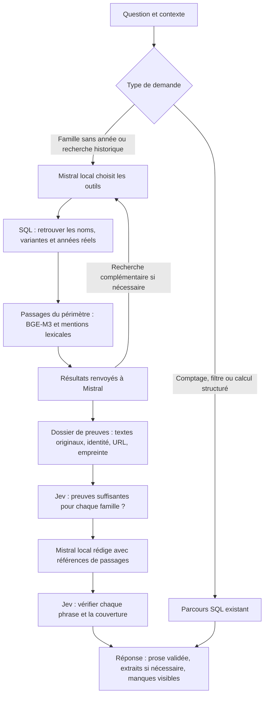

# Recherche locale dans le catalogue — 14 octobre 2026

Mistral peut maintenant choisir des recherches dans une famille de motos sans demander un millésime. Il reçoit les variantes et passages réellement trouvés, puis rédige une réponse avec leurs références. Jev reste le seul service distant du parcours : il contrôle les preuves et les phrases proposées.

## Parcours implémenté

Le modèle dispose de trois outils bornés : `research_catalog`, `lookup_models` et `search_passages`. Le premier regroupe la découverte des fiches et leur recherche. Il peut demander une nouvelle recherche après avoir lu les résultats. Les noms doivent provenir de la demande ou du contexte ; les bornes d’année doivent être explicitement données par l’utilisateur. Le modèle ne produit ni SQL libre ni appels réseau.

Chaque famille conserve son périmètre. Le contrôle de couverture empêche de considérer Honda comme une réponse suffisante à une demande Honda + BMW, ainsi que d’oublier un autre modèle reconnu de la même marque. Une édition explicite sans fiche correspondante reste inconnue ; le système ne lui substitue pas une autre variante.

La recherche historique combine les plus anciens passages contenant les termes techniques choisis et les voisins BGE. Les intitulés génériques de rubriques sont écartés des termes chronologiques. Les passages sélectionnés sont triés par année lorsqu’il existe des mentions lexicales, pour que la rédaction examine aussi les preuves anciennes. Une année lexicale concerne les termes choisis : elle ne prouve pas la toute première présence historique du fait.

## Identité et confiance

L’index local existant est réutilisé, sans réindexation globale. Ses fichiers, dimensions et révision BGE-M3 sont contrôlés. Chaque passage retenu doit correspondre au texte et aux métadonnées de la fiche SQL actuelle. Si l’index est absent ou périmé, la recherche utilise les textes SQL et le cache d’encodage local existant.

La rédaction ne cite que les identifiants de passages fournis. Jev vérifie les phrases et leur appui sur ces sources ; une confiance insuffisante retire une phrase. Le mode `mixed` publie la prose validée et conserve des extraits lorsque la couverture globale reste insuffisamment vérifiée. Ce comportement est visible dans les observations ; il ne signifie pas qu’une réponse complète a été certifiée.

Une fiche datée établit une mention dans ce catalogue. Elle n’établit pas une date officielle de lancement, la disponibilité sur tous les marchés ni celle de chaque version ou option. Une boîte manuelle avec shifter n’établit pas une boîte automatique. Une mention absente reste une preuve manquante.

## Validation observée

Le [panneau de validation](../eval_results/technical/catalog-research-20261014/verified-panel.json) contient six sessions Gradio neuves. Les réponses sont associées au reçu de leur véritable exécution et chaque extrait est comparé à la base SQL en lecture seule. Les questions ont été écrites pour cette validation ; ce n’est pas un benchmark indépendant ni une mesure de généralisation.

| Cas | Temps total | Résultat |
| --- | ---: | --- |
| Question originale Gold Wing + BMW RT | 134,10 s | Deux familles, Gold Wing DCT 2018 dans la prose validée, manque BMW explicite |
| Gold Wing, histoire de la transmission | 39,95 s | DCT robotisée documentée en 2018 ; mention explicite « double embrayage » dans une fiche 2020 |
| BMW RT sans année | 62,68 s | Sources de transmission manuelle/shifter, automatisation non établie par les passages |
| Deux familles, formulation différente | 94,01 s | Réponse sourcée pour chacune, preuve Honda 2018 et limites BMW |
| Édition Gold Wing fictive | 74,88 s | Aucune variante de remplacement, manque d’identité signalé |
| Compter les Yamaha 2020 avec ABS + shifter de série | 0,17 s | 8 fiches ; parcours SQL conservé |

Les quatre recherches publient encore en mode `mixed`. Les temps incluent Mistral, la recherche et Jev ; ils proviennent d’un seul passage par question. Le cas original n’est donc pas encore assez rapide pour un chat fluide. La suite de tests locale passe : **1 040 tests réussis, 8 ignorés**.

Une nouvelle saisie de la question originale dans le navigateur passe également : **137,33 s**, deux phrases Mistral acceptées par Jev, sept fiches sources vérifiées contre le SQL. La [capture du front](../eval_results/technical/catalog-research-20261014/frontend-original.png) montre la rédaction, les liens et l'année facultative ; le [reçu observé](../eval_results/technical/catalog-research-20261014/browser-original-receipt.json) conserve les outils réellement appelés.

La preuve Honda 2018 est la fiche **GL 1800 GOLDWING Tour DCT/Airbag**, identifiant SQL `c0a73ac3d40825ff`, dont la transmission contient « Boite à 7 rapports robotisée DCT avec marche arrière ». La validation exige que cette preuve apparaisse dans une **phrase Mistral acceptée par Jev**, avec son passage cité. La simple présence de « 2018 » dans le bloc d’extraits ne suffit plus à faire passer le cas.

## Activation et limites restantes

Activer `BIKEFINDER_CATALOG_RESEARCH=1` avec le parcours Jev/RAG et la synthèse locale. La configuration locale du poste est activée ; l’exemple de configuration garde ce parcours optionnel. Le front de validation est sur **7863**. Les anciennes démos n’ont pas été redémarrées.

Le budget par défaut est de 150 secondes, avec trois étapes de planification et huit outils au maximum. Le temps restant borne les appels Mistral ; une rédaction ne démarre pas après épuisement du budget. Les opérations CPU/SQL et les contrôles Jev en cours gardent leurs propres limites : le budget total reste coopératif, pas une échéance absolue.

Un périmètre est limité à 500 fiches et chaque recherche fournit jusqu’à trois preuves lexicales et trois voisins BGE. La détection de couverture dépend encore des noms et alias reconnus dans le catalogue. Elle doit être élargie et évaluée sur d’autres familles. Le système ne résout pas encore toutes les questions d’équipement, de variantes ou d’homologation.

Le prochain travail doit mesurer la généralisation sur des questions tenues à l’écart, réduire le nombre de tours et le dossier transmis au modèle, puis améliorer la couverture vérifiable. Les échecs précédents sont conservés dans le [journal de validation](../eval_results/technical/catalog-research-20261014/README.md).
