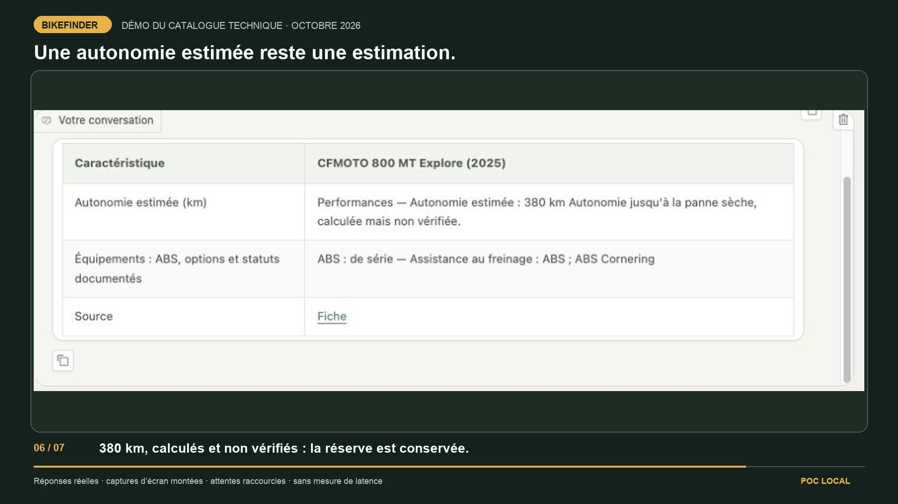

# Archived project notes — 13 October 2026

This is the former README, preserved before its reorganization. It combines
historical experiments, dated measurements and setup instructions. It is not
the current setup guide or roadmap. Commands assume the repository root.
Jev is the only remote service authorized for current project work.

See the [current README](../../README.md), [documentation index](../README.md)
and [current architecture](../reference/architecture.md).

---

# Bikefinder RAG

A **proof of concept** for a technical motorcycle catalog by model year.
The active local chat uses Jev to interpret natural questions and PostgreSQL to
return documented facts with their source URLs. Ask for price/power filters,
equipment, a model-year sheet or a comparison — for example
*"Motos en dessous de 10000 eu et minimum 100 cv en 2020"*.
BGE-M3 remains available for scoped technical passage retrieval. Mistral Small
3.2 runs locally only when the fast path needs synthesis of selected evidence.

This is a learning project and portfolio piece. Jev runs remotely through
OpenRouter using a server-side key: questions and the excerpts needed to check
a synthesis are transmitted to that service. SQL, BGE-M3 and Mistral remain
local. The legacy path can run offline after model downloads; the enabled Jev
router requires Internet. Visitors do not enter an API key.

On the controlled 480-question suite, **440 answers use data directly**, 30
ask for clarification and 10 are routed to bounded synthesis. The actual
price/power question returns nine source sheets in **0.167 s** through Gradio,
after a previous observed 180-second timeout. **525 tests passed on the initial
routing publication snapshot**, including PostgreSQL integration. These are controlled acceptance
results, not a general accuracy score. See the
[measurements and safeguards](../../docs/jev-routing-natural-questions.md).

A subsequent [free-question check](../../docs/jev-free-questions.md) exercised 54
natural questions, including seven dialogues, and fixed aliases, negations,
follow-up constraints and source-based comparisons. The active local replay
uses no Mistral calls: cached API median **0.057 s**; one additional new question
with an uncached Jev classification took **0.541 s**. Agent review of the 40
independently authored questions yields 16 complete answers and 24 justified
partial answers or clarifications after fixes. This is an adapted replay,
not a general accuracy benchmark. **605 tests pass on the exact free-question
publication snapshot**, including PostgreSQL integration, in **9.52 s**.

The [partial-answer improvement pass](../../docs/jev-partial-improvements.md) adds
explicit unit conversions, more direct source fields, complete sourced CSV lists,
safer variant handling and natural follow-ups. Five of the 24 previously partial
turns improve, including two resolved requests. After fixes, 50 new turns yield
25 complete factual answers and 25 honest source limitations; a further 20-turn
lot is fully addressed under its source-scoped review rubric. These are adapted
replays, not general accuracy scores. The final local workspace passes **922 tests**
(8 skipped), and the controlled suite remains **480/480**. The refreshed interface
and [new 43-second demo](../../docs/brag/brag-20261013.mp4) show the current local workflow.

## Direction as of 2026-10-10

The goal is to choose and compare motorcycles using documented technical
characteristics and performance: **brand → model → model year → variant**,
with market scope when the source provides it. Useful partial answers should
show the available evidence and its limits. Missing data must remain unknown;
a silent equipment field does not establish that the bike lacks ABS.

The comparison point for "two months ago" is the repository state on
**2026-08-10**, whose last preceding commit was
[`b0c0ec9` (2026-07-16)](https://github.com/maax6/bikefinder-rag/commit/b0c0ec9).
The French review corpus arrived in September, before this October refocus.

| Decision | Summer prototype | Current technical POC |
|---|---|---|
| Product focus | Buying advice combining specs, owner reviews, prices and recalls | Technical sheets and comparisons by explicit model year; reviews deferred |
| Default inference | Anthropic; Ollama available for local experiments | Remote Jev routing, direct local SQL facts, local Ollama only for necessary synthesis |
| Evidence | Structured specs plus family-level review retrieval | Structured SQL and original technical labels/units; source, year and unknowns preserved |
| Text retrieval | BGE-M3, hybrid review search and reranking | Distinct technical-passage retrieval connected to the chat; BGE-M3 vectors cached on demand within a model/year |
| Data quality | Existing typed fields and source matching | Versioned identity/measurement candidates; dry/wet weights, variants and conflicting sources audited |
| Evaluation | Review retrieval, tool trajectories, constraints and RAGAS scores | Technical acceptance cases, correct tool arguments, evidence, retry behavior, latency and memory before choosing another model |

An equipment mention is supporting text, not a verified **standard / optional /
explicitly absent / unknown** classification. A French launch price does not
establish the market of every specification. Catalogue year, first observed
year and documented launch date are separate facts.

The full Motoplanete collection is now loaded into distinct PostgreSQL tables:
**11,478 real fiches**, **31,435 equipment rows**, and **105,687 technical passages**.
Original wording, autonomy qualifications and provenance are retained. BGE-M3
retrieval is scoped to a model/year and caches embeddings on first use.
See the [complete integration and measured results](../../docs/enriched-catalog-chat.md).

## Model choices and their roles

**Mistral Small 3.2 remains the generator reference.** It was selected as the
local model on **2026-07-15**, in
[`297fb65`](https://github.com/maax6/bikefinder-rag/commit/297fb65), after a
historical tool-trajectory comparison with `mistral-small`: both reached
15/15 cases, while 3.2 avoided the observed tool-marker leakage in final prose.
It is not a new October replacement. October changed the default backend
and the task/data contract; those historical 15 cases do not validate the
new technical workload.

The current local installation was checked on 2026-10-10: Ollama **0.32.15**,
`mistral-small3.2:latest`, **24B / Q4_K_M**, approximately **15.2 GB of model
files**. The legacy agent requests a **16,384-token context**; the fast router uses a
**4,096-token context**, at most 350 output tokens and a 30-second request
budget for a single Mistral synthesis. File size is not peak
memory: the context/KV cache, runtime, database and macOS also need memory.

| Role | Current choice | Scope |
|---|---|---|
| Necessary synthesis | `mistral-small3.2` through Ollama | One bounded call over selected evidence; Jev checks claims, with direct source facts on timeout or rejected claims. Legacy tool-loop path remains available with the router disabled. |
| Embeddings | `BAAI/bge-m3` | Retained review index plus connected scoped technical retrieval, with local embeddings cached by source text. |
| Decisions, routing and evidence selection | `typesafe/jev-1.13` through OpenRouter | Active in the chat; closed decisions over user constraints and evidence, never free-form SQL or invented numeric values |
| Reranker | `BAAI/bge-reranker-v2-m3` | Retained review retrieval; not loaded by ordinary technical sheet/filter queries |
| Local evaluation judge | `qwen3.6` | Default RAGAS judge, separate from the chat generator; not needed to use the technical chat |
| Other remote experiments | Anthropic/OpenRouter; Haiku via `claude -p` for selected historical evaluations | Explicit opt-in; remote judging remains remote even when generation is local |

For the **M5 / 32 GB** target, the planned comparison favors smaller
generators that may leave more memory for context and services. Their official
Ollama pages were checked on 2026-10-10:

| Candidate | Reason to test it | Status |
|---|---|---|
| [Gemma 4 12B MLX](https://ollama.com/library/gemma4:12b-mlx) | Evaluate the MLX artifact on Apple Silicon and its advertised tool support | Planned; not installed or benchmarked here |
| [Ministral 3 14B](https://ollama.com/library/ministral-3:14b) | Smaller Mistral generator with documented French, function calling and JSON support | Planned; not installed or benchmarked here |
| [Qwen 3.5 9B](https://ollama.com/library/qwen3.5:9b) | Compact alternative; record and control reasoning behavior in the comparison | Planned; not installed or benchmarked here |

No winner has been selected. Compare the reference and candidates on identical
technical questions, corpus, tools and context budgets, with repeated cold/warm
runs and one generator at a time. Measure correct tool calls, supported claims,
useful partial answers, appropriate abstentions, total latency, memory pressure
and swap. Vendor benchmarks and a `tools` badge do not establish suitability
for this catalogue. See the [benchmark protocol](../../docs/technical-catalog-refactor.md#modèles-à-comparer-sur-m5--32-go).

## Selected workflow: avoid unnecessary generation

**Decision, 2026-10-11: keep Jev.** The POC is conclusive for routing and
selecting evidence so that ordinary factual answers do not require a generated
paragraph. SQL resolves identities, filters and lists; BGE-M3 retrieves passages
within that scope; Jev selects among defined decisions and checks whether a
passage answers the question. Supported facts and lists can be returned directly
with their source URLs. Mistral handles comparisons requiring synthesis of documented evidence.
Missing evidence remains unknown; unsupported criteria ask for clarification. Unknown equipment remains
unknown when the source cannot resolve it.

The frozen experiment covers **2,254 source sheets**, **880 equipment decisions
on 706 sheets** and **24 questions**. On 60 independently annotated source cases,
the cascade and systematic Mistral both agree with **54/60** references, including
**34/37** held-out cases. Among 173 distinct inputs containing an equipment
mention, **141 (81.5%) avoid Mistral**. The references were annotated by an
independent agent, rather than verified by manufacturers or a human panel.

For the 24 questions, median measured backend latency falls from **31.3 s to
0.45 s**, and Mistral calls from **44 to 3**. This compares the current agent loop
and the hybrid POC on the same frozen corpus through an isolated SQLite adapter.
Hybrid latency excludes precomputed query embeddings: a separate warm BGE
measurement adds about **79 ms** to the six branches using semantic retrieval.
Complex comparisons remain a limitation: both hybrid outputs were truncated at
400 tokens, and one included an unsupported interpretation of suspension travel.
This is evidence for fewer generation calls, not a demonstrated accuracy gain
or a production latency guarantee.

Jev is a **remote API** in this workflow; SQL, BGE-M3 and Mistral remain local.
That initial experiment did not change the collection or running chat.
The complete enriched catalog was connected on October 12; Jev conversation
routing was activated on October 13. The dated POC results below remain distinct
from the later live-chat acceptance tests. See the [decision record](../../docs/hybrid-workflow-decision.md)
and [complete results, errors and limits](../../docs/hybrid-poc-results.md).
The frozen source data, model outputs and vectors remain local under ignored
`data/technical/hybrid-poc/`; a fresh clone cannot replay this exact benchmark
without those artifacts.

## Technical data collection and live progress

The retained Bikez corpus has **32,395 distinct source sheets (1894–2024)**.
Its offline normalized export includes **44 identities requiring review**;
equipment passages remain unclassified. **548 historical 2024 sheets** still
contain `Loading...` placeholders.

The new Motoplanete collector preserves technical rows, equipment wording,
source URLs, UTC collection dates, response hashes and sanitized technical
snapshots. Its **11,479 discovered URLs** are resolved as of 2026-10-12:
**11,478 real fiches** and one fictional Cyberpunk fiche archived separately.
The collector waits at least **10 seconds** between
requests. The fresh sitemap attempt returned HTTP 500; this queue may therefore
miss newer fiches. A separate Wikidata run collected **3,255 candidate entities**,
not verified model-year sheets. These counts must not be added into a total of
distinct motorcycles or described as worldwide completeness.

```bash
# Resume/reuse the collector and attach its Zellij dashboard here.
.venv/bin/python scripts/start_collection_panel.py --here
# Without --here, open the dashboard in macOS Terminal.
```

The collector runs independently of the dashboard, protected from idle sleep
by `caffeinate -i`. Four Zellij panes display read-only progress, recent HTTP
codes and fiches, model-year coverage, and incidents. Each shows a refresh clock
twice per second, with data read every second. Use `--dashboard-only --refresh-dashboard` to rebuild only
the dashboard. The launcher reuses an active collector and
preserves its queue and source cooldown. Roughly **32 hours of waiting alone** are needed for the full
11.5k-URL lot, before page loading or interruptions. Raw collected files stay
outside Git; [dated reports and source-access decisions](../../docs/technical-data-collection.md)
are versioned. The latest code validation including the hybrid POC is
reported separately in each dated evaluation; test counts do not measure
catalogue completeness or model accuracy.

The [first equipment enrichment pass](../../docs/first-equipment-enrichment-pass.md)
evaluates Jev and local Mistral on 7,698 frozen source records. Its final
isolated SQLite export preserves every source row, keeps ambiguous equipment
unknown, and gives explicit source facts priority over model uncertainty.


## Current technical-catalogue demo

[](../../docs/brag/brag-20261013.mp4)

[Watch the updated demo](../../docs/brag/brag-20261013.mp4) — 43 seconds, silent, in
French. It shows the new interface and actual source-based answers: model-year
comparisons, standard equipment filters and estimated autonomy with its original
qualification. This is an edited montage of real browser captures, with waits
shortened; it is not a latency benchmark. See the [capture evidence and reproduction](../../docs/brag/README.md).

## Historical launch video

Published in September 2026, before the October technical refocus.

https://github.com/user-attachments/assets/f4d35ffb-202e-4aa6-af69-7467d7dc9862

## Why this exists

A first RAG project meant to actually learn the mechanics (local embeddings,
hand-written pgvector similarity SQL, an explicit tool-use loop) rather than
wrap a framework. The repository keeps the implementation and evaluation
reports alongside the data — the short version:

- **Corpus**: self-scraped from [bikez.com](https://bikez.com) (specs + owner
  discussion forums), not a pre-packaged Kaggle dump — see [Data source](#data-source--why-self-scrape).
  The recorded full-catalog runs cover **32,395 motorcycles (1894–2024)
  and 4,335 model families**. Review counts vary with the sources loaded;
  a result belongs to its corpus snapshot, not every installation. The
  century, 2000–2023 and 2024 datasets ship in `data/`.
- **Historical Bikez scrape filter**: `Scooter` is excluded *unless* displacement ≥ 500cc
  (keeps crossovers like the Honda X-ADV or Yamaha TMAX, drops twist-and-go
  commuters), `ATV` is always excluded, everything else — including
  `Minibike` and oddball `Prototype/concept model` entries — is kept. The
  new technical source queue keeps all published motorcycle categories.
- **Retained review corpus, without a pre-curated "top N" popular models list.**
  Historically, each scraped page's forum was checked; a motorcycle only
  received a narrative/review layer if it had ≥3
  substantive comments. The narrative subset emerges from what actually has
  discussion, not from a guessed popularity ranking.
- **Explicit technical tool-use loop** — Ollama by default, optional
  cloud backends, no orchestration framework. Two tools by default:
  `filter_specs` (typed parameters only, parameterized SQL, the LLM never
  writes SQL — plus a `count_only` mode for "how many" questions),
  and `get_bike_details` (one model's original technical sheets for an
  explicit year, with source URLs and original labels/units). Reviews are
  blocked in this path; price, A2 eligibility and family recall context are
  also outside the default tools. Legacy review retrieval remains available
  to Python callers through an explicit opt-in.
- **PostgreSQL + pgvector**, one database for both structured specs and
  review embeddings.
- **Retained comments belong to model families, not model-years.** bikez.com shares
  one discussion forum across every year and variant of a model (the same
  threads back the CB 250 K 1 1970 and the CB 250 N 1985), so comments are
  stored once per family (`model_families`), deduplicated, and every
  retrieval result carries the family's year range plus the comment's own
  post date — the agent is instructed never to attribute a comment to one
  specific model-year.
- **Retained local, multilingual review embeddings** (`BAAI/bge-m3`) — no embeddings API key
  needed. The review corpus is **bilingual since 2026-09-02**: bikez.com forum
  comments (English, `lang='en'`) and motoplanete.com owner reviews (French,
  `lang='fr'`, with a /5 `rating`) share one table and one embedding space, so a
  French question reaches both; the sparse leg runs an English *and* a French
  tsquery, and the agent is asked to phrase `query` in the user's language.
- **Evaluation**: four layers, with historical results and their limitations.
  [`scripts/eval_retrieval.py`](../../scripts/eval_retrieval.py) checks the
  retrieval layer alone, no LLM involved (data integrity, self-retrieval,
  keyword-based theme proxies and off-topic distance controls — see
  [`eval_results/retrieval/`](../../eval_results/retrieval/)).
  [`scripts/eval_tool_trajectory.py`](../../scripts/eval_tool_trajectory.py)
  scores how a model calls the tools — deterministic predicates over the
  recorded calls, no LLM judge; its findings drove the few-shot prompt,
  the Ollama options and the visible argument repair, taking mistral-small
  from 9/12 to 15/15 golden questions
  ([`eval_results/trajectory/`](../../eval_results/trajectory/)).
  [`scripts/eval_constraints.py`](../../scripts/eval_constraints.py) then checks
  the final answers themselves: every motorcycle named in a reply is
  resolved against the database and verified against the question's hard
  constraints — a historical run reported **0.0% detected violations**
  over 41 resolved mentions. The legacy checker could treat missing numeric
  data as satisfied; this is not evidence that every constraint was verified
  ([`eval_results/constraints/`](../../eval_results/constraints/)).
  [RAGAS](https://github.com/explodinggpt/ragas)
  (faithfulness, answer relevancy) then scores the full agent over the
  golden set: a historical run reports **0.76 / 0.87** (local generation
  mistral-small3.2, **remote** judge Haiku via `claude -p`, 17 questions;
  answer relevancy is available for 16). The published fully local run
  reports **0.61 / 0.76 on 12 questions** with a qwen3.6 judge. These runs
  have different configurations and do not establish a controlled gain.
  An earlier two-judge pass (qwen3.6 local
  + Haiku) converged per-question, caught two real retrieval bugs whose
  fixes lifted narratives from 0.0 to 1.0, and documented RAGAS's known
  penalty on honest "no data on record" refusals
  ([`eval_results/ragas/`](../../eval_results/ragas/)).
- **Interface**: Gradio on `127.0.0.1`, with the enabled Jev router using a
  server-side OpenRouter key. The separate cloud-generator interface asks for
  the visitor's own key.
  The Hugging Face deployment directory is a historical showcase experiment.

The first technical slice offers **sheets and simple comparisons by model
year**, with owner reviews deferred. Its [validation record](../../docs/technical-catalog-first-slice.md)
separates real SQL checks, simulated transport and actual local generation
through Gradio, including an induced timeout/retry. A [normalization pilot](../../docs/technical-catalog-normalization-pilot.md)
now produces versioned identities and measurements without modifying the database.
A [technical data collection pipeline](../../docs/technical-data-collection.md) now
audits the retained sources, exports local technical records and collects
Motoplanete equipment/specifications separately, with resumable provenance.
The [refactor issue](https://github.com/maax6/bikefinder-rag/issues/2)
and [local plan](../../docs/technical-catalog-refactor.md) cover the remaining
identity/measure corrections, equipment/colors and model evaluation for an
M5 with 32 GB. Legacy typed weight columns still mix dry and wet values; use the original
labels, and do not derive a power/weight ranking from these legacy columns.

## Which model years do the reviews cover?


Each dot is a **model year present in the three selected datasets**:
`data/century`, `data/2000s` and `data/demo`, checked on 2026-10-10. The
interval joins the earliest and latest years of a family; gaps between
dots are gaps in this selection, not necessarily in other bundled datasets
or the database. The comment counts are deduplicated Bikez comments from
these same files.

For example, Honda CB 250 entries span **1967–2020** in these files. Their
comments form one shared family pool: that range does **not** establish
owner testimony for every year or generation. A comment's publication date
(`posted_at`) is separate from the family's model-year range
(`family_year_min` / `family_year_max`).

This is an illustrative selection, not the full review inventory. French
Motoplanete reviews also join model families in the local database; they
are outside this figure. Coverage depends on the datasets loaded locally.

## Data source & why self-scrape

There's an existing Kaggle dataset (`all_bikez`, labelled CC0) scraped from
bikez.com in 2022. The original project collected its own specs and forum
comments to study the full pipeline and extend
[github.com/maax6/Bikefinder](https://github.com/maax6/Bikefinder). That historical
choice does not establish permission for further Bikez collection, nor does a
dataset label override the original source's terms.

**Access audit, 2026-10-10:** Bikez's robots.txt permits the historical
technical paths, but its [About page](https://bikez.com/about/index.php)
requires prior written permission for reproduction. Robots access does
not establish permission to reuse a database. The new collection pipeline
therefore does **not** extend the Bikez crawl; existing local files are
preserved with their provenance and restrictions. Do not redistribute
them as an open dataset. Permission from the publisher remains necessary
before extending this source.

## ⚠️ Known limitation: price data

**bikez.com has no price field at all** (verified against both the 2022
Kaggle dataset's validation report and a live fetch of a well-documented,
recent model — 0% coverage either way). Price was judged important enough
to the project's original intent (this started life as "Bikefinder" — find
a motorcycle to *buy*) to be worth a second source, but the obvious French
marketplaces block that outright:

| Site | Result |
|---|---|
| Leboncoin | `robots.txt`: *"forbidden to use search robots... access only with special permission"* |
| La Centrale | DataDome anti-bot (CAPTCHA-gated) |
| ParuVendu | `robots.txt` disallows exactly the `/auto-moto/*` paths |
| **Motoplanete** | Rechecked 2026-10-10: published technical fiches, specifications and equipment; robots `Crawl-delay: 10`. Used for this local non-commercial POC; its CGU prohibit commercial exploitation and do not grant an open redistribution licence. The new technical collector enforces at least 10 seconds, preserves source rows and never treats a price country as the market of every specification. |
| **Motoplanete — owner reviews** | ✅ **viable, same terms** (re-checked 2026-09-02): every fiche carries an "Avis des motards" block — owner reviews written in French with a /5 rating, the reviewer's model year and a date, server-rendered (no AJAX), pooled per model rather than per model-year. Crawled one fiche per (brand, model) at the site's `Crawl-delay: 10` — see [`scripts/scrape_motoplanete_reviews.py`](../../scripts/scrape_motoplanete_reviews.py). |
| Moto-Station (Maxitests) | Owner-written long-form tests, `robots.txt` open to generic agents — **but** it disallows the whole site to every named AI crawler (GPTBot, ClaudeBot, anthropic-ai, CCBot…). A RAG *is* that use, whatever User-Agent string we send — dropped. |
| Le Parking Moto | `robots.txt` permissive, **but** CGU (checked 2026-07-16) explicitly forbid robots/spiders and any reuse "à des fins commerciales ou non" without express authorization — dropped; asking for authorization remains possible. |
| AutoScout24 | search pages (`/lst-moto?`), GraphQL APIs and AI crawlers all disallowed, no offer sitemap — no clean discovery path. The 2022 used-price snapshot in `data/` is a ZenRows *sample* of this site, used as a dated cote only. |

We don't scrape against an explicit prohibition or bypass anti-bot protection
(Le Repaire des Motards was probed for French owner reviews and serves an
active human-check page to automated clients — dropped, whatever its
robots.txt says).

**Historical enrichment run** —
`scripts/scrape_motoplanete_prices.py` collected 11,418 fiches (93% with a
French launch price, 100% with a curated category), and
`scripts/load_motoplanete_prices.py` matched 9,390 of them (82%) onto our
motorcycles: **7,137 bikes carried a French MSRP** in `msrp_eur` (22% of
the catalog, 25-29% of each decade since 1990) and
7,356 a clean `category_fr` (Roadster, Sportive, Trail, Supermotard...) —
used as a cross-check against bikez's loose categories, which mislabel
e.g. recent Transalps as 'Super motard'. Coverage is still partial, and
the agent is instructed to say "no price data" plainly rather than imply a
bike is unaffordable or doesn't exist. These coverage figures precede the
October 2026 matching correction: the old fallback could confuse numeric
model identifiers (for example CBF500 and CBF600N). Corrected code prevents
those matches on future imports; existing enrichments need a separate audit
and rebuild before their coverage or correctness is re-published.

A read-only replay of 11,416 plausible fiches with the revised matcher
reduced automatic matches from 9,390 to 6,821. All 346 previously identified
priced cases with disjoint numeric identifiers lose that contradiction;
this is a diagnostic proxy, not a human validation of every new match.
The conservative rule deliberately leaves more ambiguous names unmatched.

Two retained enrichment layers have their own idempotent loaders. They are
outside the default technical chat evidence:

- **US safety recalls** (`scripts/load_nhtsa_recalls.py`): NHTSA's free
  flat files, 3,521 campaign rows matched onto 431 model families — the
  project's historical recall layer, available through the opt-in legacy
  family context with an explicit "US market only" caveat. A recall count
  alone is not a reliability ranking.
- **Indicative used prices** (`scripts/load_used_prices.py`): median and
  quartiles per (family, registration year) aggregated from a 2022
  European marketplace snapshot (Kaggle, ~18k deduplicated listings, 598
  families) — a dated cote indicative, presented as such, never as
  today's market value.

## Architecture

```
Local Gradio UI (127.0.0.1, no visitor key)
        │
        ▼
Jev via OpenRouter → validated closed query plan
        │
        ├── facts / filters / counts → local PostgreSQL → sourced answer
        ├── unclear / unsupported   → explicit clarification
        └── necessary synthesis    → selected local evidence → Ollama Mistral
                                      → Jev claim check → answer or source facts
```

BGE-M3 provides scoped technical retrieval through `search_technical`, with
vectors cached on demand. Plain structured filters do not load it. The legacy
agent and retained owner-review pipeline remain separate paths.

Technical collection runs separately: source pages → versioned raw records
and SQLite queue → frozen enrichment → distinct PostgreSQL catalog tables.
The loaded raw rows retain their wording, autonomy qualifications and source
hashes. Numeric projections distinguish dry/wet weight and reject stale hashes.

## Project layout

```
src/bikefinder_rag/
  catalog/        enriched runtime tables, measures and migration candidates
  scraper/        list_scraper.py, detail_scraper.py, categories.py, http.py
  db/             schema.sql, client.py
  embeddings/     embedder.py (BGE-M3)
  agent/          loop.py, tools.py, catalog_tools.py, jev_router.py
  eval/           golden_questions.json, run_ragas.py
  app.py          Gradio interface
scripts/
  run_pilot_scrape.py            stratified sample (categories x decades x brands)
  load_db.py                     loads scraped JSONL into Postgres, embeds comments
  scrape_motoplanete_prices.py   French prices + categories (11.4k fiches)
  scrape_motoplanete_reviews.py  French owner reviews, one fiche per model (3.7k fiches)
  load_motoplanete_prices.py     matches fiches onto motorcycles (msrp_eur, category_fr)
  load_nhtsa_recalls.py          US safety recalls onto model families
  load_used_prices.py            2022 used-price aggregates onto model families
  load_motoplanete_reviews.py    French owner reviews onto model families (lang='fr', rating)
  eval_retrieval.py              layer-1 eval (retrieval alone, no LLM)
  eval_tool_trajectory.py        layer-1.5 eval (tool calls, no LLM judge)
  eval_technical_demo.py         sequential real Gradio technical probes, manual review
  audit_technical_normalization.py  bounded read-only migration-candidate audit
  collect_technical_data.py      resumable Motoplanete technical/equipment crawl
  collect_wikidata_motorcycles.py  bounded global identity inventory
  export_local_technical_data.py  offline technical export with provenance
  audit_collected_technical_data.py  field/year coverage from read-only SQLite
  load_enriched_catalog.py       frozen SQLite snapshot → local PostgreSQL + measures
  evaluate_jev_routing.py        controlled natural-question routing evaluation
```

## Running it locally

Prerequisites: Python 3.11+, a running Docker engine with Compose, and Ollama.
Start with the pilot corpus; loading the entire catalog is optional and much
more expensive. The examples below explicitly select the local backend even
if an existing `.env` still selects a cloud provider.

```bash
python3.11 -m venv .venv
.venv/bin/python -m pip install -e '.[dev]'
test -f .env || cp .env.example .env
export AGENT_BACKEND=ollama

# Start Ollama in another terminal with `ollama serve` if it is not running.
# The first pull needs Internet and enough disk/RAM for the chosen model.
ollama pull mistral-small3.2
docker compose up -d --wait postgres

# Minimal demo: the pilot data ships with the repo. The first embedding
# operation downloads BGE-M3; the first review search downloads the reranker.
PYTHONPATH=src .venv/bin/python scripts/load_db.py data/pilot

# Chat in the browser (http://127.0.0.1:7860), or use scripts/chat_cli.py.
PYTHONPATH=src .venv/bin/python src/bikefinder_rag/app.py
```

For the current fast enriched-catalog chat, first prepare the frozen SQLite
export locally, then import and enable the router. The source snapshot and
question corpus are not bundled in Git. In `.env`, configure
`OPENROUTER_API_KEY`, `BIKEFINDER_JEV_ROUTER=1`,
`JEV_ROUTER_TIMEOUT_SECONDS=5` and `CATALOG_SYNTHESIS_TIMEOUT_SECONDS=30`.

```bash
PYTHONPATH=src .venv/bin/python scripts/load_enriched_catalog.py \
  --source data/technical/enrichment-full-20261012/pass2/catalogue.enriched.sqlite3
PYTHONPATH=src .venv/bin/python src/bikefinder_rag/app.py
```

Set `BIKEFINDER_JEV_ROUTER=0` to use the legacy local path. Jev classification
failure returns a clarification instead of starting the slow generator loop.

With the Jev router disabled, local model loading and generation can take
several minutes. The legacy Ollama agent has a
**180-second cooperative budget per user turn** (`OLLAMA_TURN_TIMEOUT_SECONDS`)
and a **300-second read timeout cap per request** (`OLLAMA_TIMEOUT_SECONDS`).
Each request uses the smaller of its cap and the remaining turn budget;
successive tool calls do not restart that budget. Set positive finite values
in `.env` to adjust either limit.

The budget is checked before requests and tools and after each operation.
An in-progress DB/CPU tool is not interrupted, so it can overrun the budget;
HTTP read timeouts also do not guarantee a hard wall-clock deadline. Once
exhaustion is detected, no further operation starts. Budget exhaustion,
slow-response read timeouts and connection failures have separate messages.
These settings do not change the cloud backends' timeouts.

Failed local attempts remain visible in the chat, but their incomplete tool
traces are excluded from the model's conversation state. A standalone `retry`
or `réessaie` repeats the most recent substantive question; successful tool
turns keep their evidence for follow-up questions.

Compose persists PostgreSQL in a named volume and only exposes its port on
`127.0.0.1`. Its initialization SQL runs once for a new volume. To apply the
current idempotent schema to an existing Compose database:

```bash
docker compose exec -T postgres sh -c 'psql -v ON_ERROR_STOP=1 -U "$POSTGRES_USER" -d "$POSTGRES_DB"' \
  < src/bikefinder_rag/db/schema.sql
```

For an offline session, prepare **both** local Hugging Face models once while
online, then set `HF_HUB_OFFLINE=1` in `.env`:

```bash
PYTHONPATH=src .venv/bin/python -c 'from bikefinder_rag.embeddings.embedder import embed_text; from bikefinder_rag.embeddings.reranker import rerank; embed_text("motorcycle"); rerank("motorcycle", ["owner review"])'
```

Ollama's model must also have been pulled. The scraper and the optional
NHTSA/Kaggle loaders still need Internet; they are separate preparation
steps. `RERANKER_ENABLED=0` skips the second model at a ranking-quality cost.

Optional full-catalog imports and enrichments:

```bash
# Same AGENT_BACKEND=ollama setting as above. Full embedding is costly,
# including on repeat imports: existing rows are skipped only after encoding.
PYTHONPATH=src .venv/bin/python scripts/load_db.py data/demo
PYTHONPATH=src .venv/bin/python scripts/load_db.py data/century
PYTHONPATH=src .venv/bin/python scripts/load_db.py data/2000s

# Optional enrichment layers, after load_db:
PYTHONPATH=src .venv/bin/python scripts/load_motoplanete_prices.py  # French MSRP + category_fr
PYTHONPATH=src .venv/bin/python scripts/load_nhtsa_recalls.py       # US safety recalls
PYTHONPATH=src .venv/bin/python scripts/load_used_prices.py         # 2022 used-price cote
PYTHONPATH=src .venv/bin/python scripts/load_motoplanete_reviews.py  # French owner reviews (lang='fr')
# The French reviews file is required for the last command; crawl it first
# with scripts/scrape_motoplanete_reviews.py if it is absent in your checkout.

# New technical collection: source rules and resume commands are documented
# in docs/technical-data-collection.md. No new Bikez crawl is enabled.
```

## Evaluating

```bash
# Technical path: demo, Ollama and PostgreSQL already running, full catalog loaded.
# Records answers for manual review; stops after a transport error.
.venv/bin/python scripts/eval_technical_demo.py

# Versioned normalization pilot: PostgreSQL reads only, no model or DB writes.
PYTHONPATH=src .venv/bin/python scripts/audit_technical_normalization.py

# Layer 1 — retrieval alone, no LLM (writes a dated report under eval_results/retrieval/):
PYTHONPATH=src .venv/bin/python scripts/eval_retrieval.py

# Layer 1.5 — tool-call trajectories, deterministic checks, no LLM judge
# (one model per run; writes a dated report under eval_results/trajectory/):
AGENT_BACKEND=ollama OLLAMA_MODEL=mistral-small3.2 EMBEDDER_DEVICE=cpu \
  PYTHONPATH=src .venv/bin/python scripts/eval_tool_trajectory.py

# Layer 1.75 — hard-constraint violation rate of the final answers
# (writes a dated report under eval_results/constraints/):
AGENT_BACKEND=ollama OLLAMA_MODEL=mistral-small3.2 EMBEDDER_DEVICE=cpu \
  PYTHONPATH=src .venv/bin/python scripts/eval_constraints.py

# Layer 2 — fully local RAGAS: pull the judge before running this command.
# Generation and judge are deliberately different local models.
OLLAMA_MODEL=mistral-small3.2 RAGAS_JUDGE_MODEL=qwen3.6 \
  EMBEDDER_DEVICE=cpu AGENT_BACKEND=ollama \
  PYTHONPATH=src .venv/bin/python -m bikefinder_rag.eval.run_ragas

# Data-coverage dashboard (self-contained HTML, spot what to fill next):
PYTHONPATH=src .venv/bin/python scripts/coverage_dashboard.py

# Regression tests (no database, model download or LLM call):
.venv/bin/python -m pytest -q
```

Use `RAGAS_JUDGE_MODEL=claude-cli:haiku` only for an explicitly **remote**
judge experiment. A subscription without an API key still uses a cloud model.
RAGAS can resume cached answers only when the generation identity and corpus
match; `--regenerate` explicitly discards incompatible answers. Changing the
judge alone permits re-scoring the same generated answers.

Cache verification requires the database and the generator's Ollama server
even when re-scoring answers: their identities are checked before reuse.

New evaluation reports include run provenance. Historical JSON files are
preserved as recorded; they are not a fresh validation of the current code.
Self-retrieval is a plumbing check, theme regexes are relevance proxies, and
off-topic distance controls do not implement an abstention policy. See
[`eval_results/README.md`](../../eval_results/README.md) before quoting a score.

## Data licensing

The **code** is MIT-licensed (see [LICENSE](../../LICENSE)). The **datasets in
`data/`** are compilations of third-party sources and keep their sources'
terms:

- `data/pilot`, `data/demo`, `data/century`, `data/2000s` — scraped from
  Bikez historically. Its current About page requires prior written
  permission for reproduction; robots.txt alone is not a licence.
- `data/motoplanete` — prices and categories from motoplanete.com, whose
  CGU prohibit commercial exploitation. This is not an open redistribution
  licence. The new `data/technical/motoplanete` records have the same source
  restrictions and remain outside version control.
- `data/technical/wikidata` — structured Wikidata inventory, CC0; source
  entity IDs and query provenance retained, without inventing model years
  or equipment specifications.
- NHTSA recalls (downloaded at load time, not committed) — US public
  domain government data.
- The 2022 used-listings snapshot (fetched from Kaggle at load time, not
  committed) — ZenRows' free sample; only aggregates are stored in the
  database.

## Roadmap

The [technical refactor issue](https://github.com/maax6/bikefinder-rag/issues/2)
is the current roadmap. The first sheet/comparison slice is delivered;
identity/measurement normalization is a versioned pilot; expanded technical
collection and its monitor are implemented. Next: validate and import the
normalization, classify equipment by variant/market, add equipment/color
search and a versioned technical-passage index, then compare local generators
on the same evidence. Each stage needs its own acceptance record.

### Retained historical work

1. Price enrichment and `category_fr` loaders are implemented; audit and
   rebuild existing enrichments after the numeric matching correction before
   publishing refreshed coverage. The former A2 estimate remains documented
   in historical reports; `a2_only` is **not supported by the current technical
   tools**. That earlier estimate did not verify approved restriction kits,
   and its source mixed wet and dry weights.
2. ~~Scale scraping beyond the 2024 demo year~~ **done** (century +
   2000-2023 crawls: 32,395 bikes in the recorded full-catalog runs)
3. Shared entity resolution across sources is implemented
   (`src/bikefinder_rag/matching.py`): one token-level matcher shared by
   the enrichment loaders; the used-price cote now reaches families
   through concrete model-year rows instead of family names. October 2026
   regressions protect numeric model identifiers; ambiguous matches still
   need source-specific auditing.
4. RAGAS `context_precision`/`context_recall` (needs a hand-curated
   ground-truth set, deferred — faithfulness/answer_relevancy don't need one)
5. **Cross-lingual retrieval — shipped, and measured on the shipped path
   (2026-08-31).** `search_reviews` is three-stage: dense HNSW shortlist +
   English/French full-text shortlists (GIN, websearch with OR fallback) fused by
   reciprocal rank fusion, then `bge-reranker-v2-m3` reranks the pool. The
   agent is instructed to keep `query` in the user's language. Reranking is
   skippable via RERANKER_ENABLED=0. The measurements below are the
   **historical English-corpus baseline**, before French reviews were added;
   they do not measure the current bilingual corpus.

   On-topic hits in a query's top-10, keyword proxy, five themes (/50):

   | dense | + reranker | **`search_reviews`, FR query** | **`search_reviews`, EN query** |
   |---|---|---|---|
   | 14 | 22 (+57%) | **20 (+43%)** | **18 (+29%)** |

   The `+57%` this section used to advertise is the middle column: a
   dense-plus-reranker measurement taken on 2026-07-15, the day *before*
   hybrid retrieval landed. The eval reimplemented retrieval instead of
   calling `search_reviews`, so nothing re-measured it and the gain was
   attributed to a pipeline that had never been evaluated. The two right
   columns call the shipped function.

   **Two candidate fixes were measured, and neither works.** Dropping the
   sparse OR fallback — which matches 226 documents on stray tokens for a
   French phrase where the AND branch matches none, letting RRF evict 14-19
   genuine dense candidates — moves the score by +1 FR / -1 EN. Growing the
   dense pool from 50 to 400 leaves the total flat (21, 21, 21, 20); it only
   shuffles hits between themes. So the ceiling is neither the fusion nor
   dense recall, and the honest state of this metric is *measured, not
   solved for that historical configuration* — see
   [`eval_results/retrieval/`](../../eval_results/retrieval/).
6. ~~Hugging Face Spaces deployment~~ **shipped as a static showcase**:
   [huggingface.co/spaces/masonpaint/bikefinder-rag](https://huggingface.co/spaces/masonpaint/bikefinder-rag)
   (proof documents, eval results, a real captured session). The full
   Docker Space (Postgres + agent in one container, `deploy/`) is retained
   as a historical hosting experiment. The supported POC workflow is local;
   hosting availability and pricing have not been re-checked in this revision.

## Natural-question routing — 2026-10-13

The final controlled suite passes 480/480 questions: 440 direct factual answers,
30 clarifications and 10 cases classified for bounded Mistral synthesis. These
are acceptance tests, not an independent accuracy benchmark. The original
price/power question now returns nine source sheets in 0.17 seconds through the
live chat API; its previous observed attempt timed out at 180 seconds.

See [measurements and safeguards](../../docs/jev-routing-natural-questions.md) and
[the result artifact](../../eval_results/technical/jev_routing_20261013.json).

The subsequent free-question run and its remaining source limits are documented
in [the free-question report](../../docs/jev-free-questions.md), with
[aggregate results](../../eval_results/technical/free_chat_results_20261013.json).
The exact free-question publication snapshot passes 605 tests; the full local
workspace passes 622, including separate collection/Zellij work. The previous
controlled suite still passes 480/480. The earlier publication snapshot counts
above remain historical measurements.

The [next improvement report](../../docs/jev-partial-improvements.md) preserves first-pass
and adapted scores separately. The additional unseen lot's first API pass has
median 0.419 s and P95 0.769 s; final replays reuse many cache entries. All 124 final
API turns avoid Mistral. Exact-source Bikez complements can supply missing ground
clearance and cruise-control mentions, with their own provenance and unknown
market/fitment qualifiers. See the
[aggregate checks](../../eval_results/technical/partial_chat_improvements_20261013.json).
