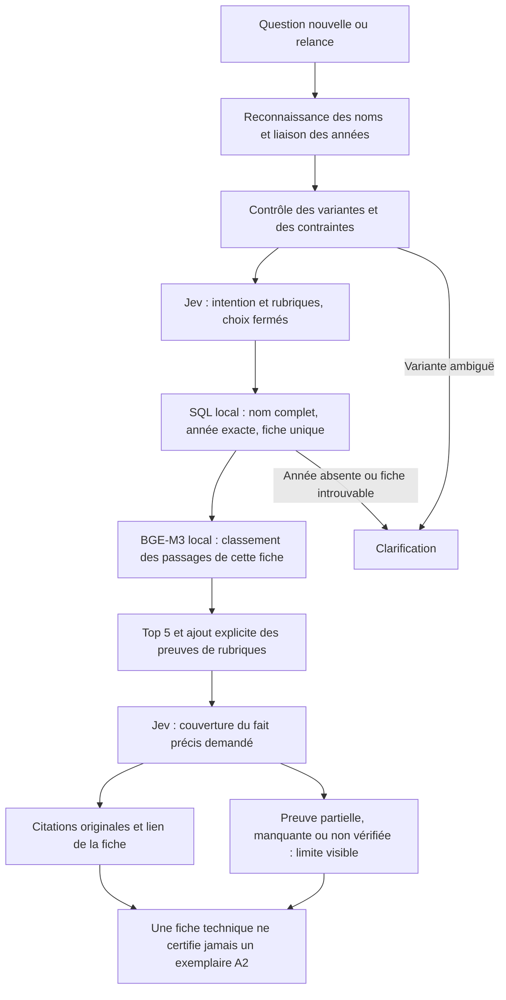

# RAG raccordé au parcours Jev — validation A2

Le chat lit désormais des passages BGE-M3 locaux après validation d'une fiche
unique en SQL. Il restitue les mentions originales, leurs unités et leur source,
et distingue un fait cité d'une réponse complètement prouvée. Jev reste le seul
modèle distant, via son API de décisions OpenRouter. Aucun générateur, juge
extérieur ou téléchargement de modèle n'a été utilisé pour ces essais.

Le parcours est activé dans le `.env` local avec `BIKEFINDER_JEV_ROUTER=1` et
`BIKEFINDER_JEV_RAG=1`. L'instance de validation tourne sur
[le chat local 7861](http://127.0.0.1:7861/). La démo existante sur 7860 n'a pas
été redémarrée ; un processus déjà démarré ne recharge pas automatiquement le code.

## Parcours réellement exécuté



- Identité : égalité SQL sur le nom complet et la marque, insensible seulement à
  la casse, plus l'année exacte. Une fiche unique est exigée. Aucune autre année
  ou variante n'est substituée. Les comparaisons restent séparées par fiche.
- Recherche : paragraphes originaux enrichis du nom, de l'année et du titre de
  section. BGE-M3 encode chaque nouvelle question ; seuls les vecteurs des
  documents et les décisions Jev sont mis en cache. Les réponses ne sont pas
  apprises puis ajoutées à une FAQ.
- Preuves : identifiant de passage, identité SQL, URL, empreinte de source,
  texte original, rang, score, motif de sélection et état de couverture sont
  conservés dans l'état du chat et les traces de validation.
- Manques : absence d'une mention A2, détail non établi, certificat absent,
  configuration individuelle inconnue ou contrôle Jev non vérifié sont
  signalés. Une absence de mention ne devient pas une incompatibilité réelle.

Le cache de vecteurs est lié au texte, à la source et à la révision BGE. Il vérifie
sa forme, ses valeurs et son empreinte ; un fichier endommagé est recalculé.
BGE-M3 est fixé à `5617a9f61b028005a4858fdac845db406aefb181`, chargé exclusivement
depuis le cache local. Le corpus SQL comprend **11 478 fiches**. Ce parcours
classe les sections de la fiche identifiée, plutôt que de laisser la similarité
choisir une moto parmi tout le catalogue. Le reranking global n'est pas activé,
conformément aux erreurs d'identité observées dans le
[benchmark précédent](technical-retrieval-benchmark-20261013.md).

Les filtres et comptages structurés gardent SQL. Les lectures techniques hors
A2 conservent le rendu existant et ses qualifications, avec les preuves RAG
ajoutées. Une question réelle hors A2 a confirmé la puissance **44 ch à
9 500 tr/min** et le couple **3,90 mkg à 7 250 tr/min** de la KTM 390 Duke 2023.

## Ce que la validation montre

Les questions ont été écrites par l'agent de réalisation et gelées avant leur
première exécution. Elles ne reprennent pas les 50 formulations du benchmark
précédent. Il ne s'agit pas d'un panel humain indépendant ni d'une évaluation
aveugle. Les premiers résultats et les rejeux sont conservés séparément.

| Série | Contrôles réussis | Lecture du résultat |
|---|---:|---|
| 20 nouvelles questions, premier passage | 3/20 | Intitulés regroupés par casse, refus excessifs et rubriques omises détectés |
| 20 questions rejouées, v6 | 20/20 | Identité, passages, valeurs demandées ou limites explicites vérifiés |
| 6 formulations supplémentaires, premier passage v5 | 5/6 | Demande de poignées chauffantes omise par Jev |
| Ces 6 questions rejouées, v6 | 6/6 | Rubrique demandée prise en compte et preuve non établie signalée |

Les corrections portent sur l'identité et le vocabulaire des rubriques du
catalogue : noms de mesures, unités et équipements. Elles n'ajoutent ni réponses
préfaites, ni valeurs inventées, ni nouvelles questions à la base de connaissances.

Sur les **26 cas finaux**, 21 donnent des citations et 5 demandent une précision
ou signalent une identité/autorité absente. Les cas comprennent Suzuki SV650
contre SV650X, Honda E-Clutch, Duke 2023 contre 2024, relance vers 2025, années
introuvables, millésime absent, édition imaginaire, certificat demandé et tentative
d'imposer une homologation. Toutes les citations contrôlées correspondent aux
passages de la bonne fiche ; aucun verdict d'homologation n'est émis.

**26/26 contrôles ne signifie pas 26 réponses complètes.** Les 21 réponses sourcées
restent `rag_partial` : parmi les 41 rubriques annotées comme demandées dans le
jeu de validation, Jev en marque 16 complètement couvertes et 25 non vérifiées. Les
mentions disponibles restent lisibles avec leur limite. Les 36 contrôles de
valeurs originales (puissance, selle ou permis) passent ; les autres citations
et qualificatifs ont aussi été relus contre les traces sources.

## Vitesse mesurée sur le vrai chat

Mac Apple M5, 32 Go. Le premier appel API est mesuré avant toute inspection
séparée du routeur. Les mesures incluent la file du chat, SQL, BGE et Jev.
Le cache des décisions Jev v6 démarre vide ; les documents ont déjà été encodés
pendant les essais précédents, avec 22 recherches sur fiche et 22 caches document
réutilisés. Chaque question est néanmoins encodée à nouveau.

| Parcours final | Médiane | P95 | Maximum |
|---|---:|---:|---:|
| 26 questions, clarifications comprises | 0,82 s | 1,14 s | 7,14 s |
| 21 réponses sourcées seulement | 0,85 s | 1,17 s | 7,14 s |

Le maximum est le premier appel après redémarrage de l'instance, comprenant son
chargement initial. Ce résultat ne mesure pas un import ou un encodage initial
de tout le catalogue. Les 26 questions évaluées créent **45 reçus Jev réussis** :
généralement une décision d'intention et une vérification par fiche. Le tour
d'amorçage de la relance est exclu de ce total ; il utilise ici des décisions
déjà en cache. Les échecs avant réception ne sont pas un compteur de consommation.

L'inspection ultérieure réutilise les décisions/documents, mais peut charger son
propre modèle local au premier tour. Ses temps BGE ne sont donc pas présentés
comme une décomposition des temps du serveur. La configuration d'encodage n'est
pas le benchmark fp16 précédent ; aucune égalité de vitesse n'est supposée.

## Confiance et limites restantes

La confiance repose sur une identité vérifiable et une citation fidèle. Le score
Jev est une mesure d'interprétation conservée dans les traces ; il ne remplace pas
SQL et n'est pas une probabilité calibrée d'éligibilité. Un choix `unresolved`
reste bloquant. Un score faible de couverture n'autorise pas `covered=true`.

Jev peut encore sélectionner des rubriques supplémentaires ou manquer une
formulation inhabituelle. Les noms explicites de colonnes, unités et équipements
protègent les demandes usuelles contre leur omission. Les éditions nommées sont
contrôlées avant/après l'année ; un suffixe nu après l'année, sans mot
« édition/version », dépend encore de l'interprétation Jev. SQL confirme la
fiche retenue, sans rendre toute compréhension linguistique infaillible.

Ce module lit jusqu'à trois fiches nommées. Il ne classe pas toutes les motos
comme légalement compatibles A2, ne garantit pas la vérité d'une source tierce
et ne prouve pas le bridage d'un véhicule individuel. Pour cela, il faudra des
preuves officielles locales, datées et reliées aux variantes, puis une validation
indépendante de la couverture sémantique. La sélection des seules rubriques
utiles reste également à améliorer.

## Vérification et reproduction

**985 tests passent, 8 tests d'intégration opt-in sont ignorés.** Les 38 tests du
nouveau module couvrent notamment variantes, années, relances, cache corrompu,
colonnes omises, détails non prouvés, panne Jev et absence de repli vers un
générateur. Le vrai SQL et le vrai chat sont vérifiés dans les essais ci-dessus.
Les revues Standards et Spec n'ont pas de blocage restant.

Les [questions, premiers passages, rejeux, reçus et empreintes](../eval_results/technical/jev-rag-20261013/README.md)
permettent d'auditer le résultat. La validation porte sur le checkout actuel,
qui comporte aussi des travaux préexistants non commités. Le routeur Jev
préexistant et les données sources ont été préservés ; les dépendances et
empreintes pertinentes sont consignées dans le manifeste.

Le lanceur `scripts/evaluate_jev_rag.py` exige un nouveau fichier de sortie et
refuse d'écraser un résultat précédent. Exemple de rejeu sur une instance locale
déjà démarrée avec les deux flags Jev :

```sh
HF_HUB_OFFLINE=1 TRANSFORMERS_OFFLINE=1 GRADIO_ANALYTICS_ENABLED=False \
  .venv/bin/python scripts/evaluate_jev_rag.py \
  --questions eval_results/technical/jev-rag-20261013/questions.frozen.json \
  --url http://127.0.0.1:7861/ \
  --out eval_results/technical/jev-rag-20261013/mon-rejeu.json \
  --label rejeu
```

Pour utiliser un cache de décisions distinct, définir le même
`BIKEFINDER_RAG_ROUTER_CACHE` dans le serveur et le lanceur. Un rejeu utilisant un
cache rempli mesure un parcours plus chaud, et doit être identifié comme tel.
