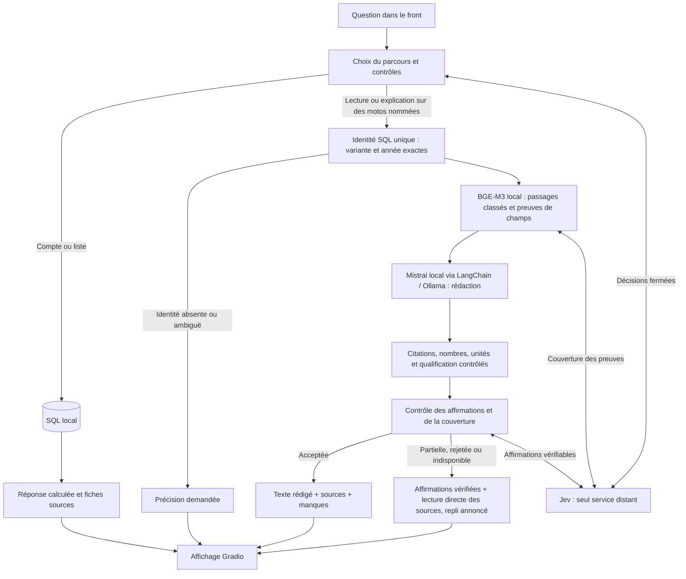

# RAG → Mistral local : connexion et validation

Le parcours Jev transmet maintenant les passages récupérés par BGE-M3 à
Mistral Small 3.2 local. Mistral rédige la réponse ; le code conserve les
identités SQL, fabrique les liens de source et ajoute les preuves manquantes.
Les affirmations rejetées sont retirées. Une rédaction partiellement vérifiée
est complétée par les données originales ; sans affirmation vérifiée, le repli
vers les sources est annoncé.

Cela démontre un raccordement fonctionnel. Cela ne démontre ni un assistant
moto général, ni un RAG parfait, ni une fidélité garantie par un score Jev.

## Parcours réellement exécuté



Les lectures factuelles et les explications acceptées utilisent le même
dossier de passages. Le générateur ne construit pas de SQL, ne relance pas
une recherche et ne consulte pas le Web. Les comptes et listes restent des
requêtes SQL ; le bouton Yamaha ne devient donc pas une génération Mistral.
Hors contexte A2, les calculs et conversions explicitement reconnus gardent
leur rendu Python sourcé : Mistral ne doit pas effacer le résultat calculé.

## Ce qui protège la réponse

- Une identité exige une ligne SQL unique pour la marque, le nom complet et
  l'année. Une fiche absente n'est pas remplacée par une année voisine.
- BGE-M3 reste local et utilise ses poids déjà installés. Les passages sont
  conservés avec leur texte, identité, URL et empreinte. Le contexte Mistral
  correspond à ces passages, pas à une seconde lecture libre du catalogue.
- Mistral produit des paragraphes avec des identifiants de passage. Les URL
  et les noms des liens proviennent exclusivement des lignes SQL.
- Les identifiants ne servent pas de preuve numérique. Les nombres et leurs
  unités doivent être présents dans les passages cités. Les dimensions avec
  unité commune, par exemple `80 x 62.1 mm`, gardent leur unité d'origine.
- Chaque affirmation passe un contrôle Jev fermé. Un choix rejeté ou une
  confiance insuffisante sur une affirmation empêche sa publication. Un contrôle
  de couverture positif mais incertain affiche « Couverture non vérifiée ».
  Une omission disponible détectée impose un complément de lecture directe des sources.
- Les mentions A2 restent explicitement des mentions de fiche. Le certificat
  individuel et l'homologation ne sont jamais établis par ces fiches. Les
  notices de manque et cette limite sont ajoutées par le code.
- Un dépassement de délai, un contexte trop long, des sources inconnues ou
  une génération concurrente donnent un repli visible ; aucun autre LLM
  distant n'est appelé.

Ces contrôles se complètent. La présence d'une unité ou de « de série » dans
un passage ne prouve pas à elle seule son attribution au bon fait. Ce dernier
point dépend encore du contrôle sémantique, qui peut se tromper : une erreur
de qualification a précisément été repérée manuellement pendant les essais.

## LangChain : usage limité et utile

`langchain-ollama` était déjà installé pour l'évaluation. Il est maintenant
utilisé dans `agent/rag_synthesis.py` pour appeler Mistral avec une sortie JSON
bornée. Versions vérifiées : ChatOllama 1.1.0, LangChain Core 1.4.9,
SDK Ollama 0.6.2, Gradio 6.20.0.

L'identité, la récupération BGE et les contrôles métier restent explicites.
Pas de migration du stockage, de nouveau service ni d'agent autonome ajouté.
LangSmith est désactivé pour cette rédaction. Le client Ollama accepte
uniquement l'interface locale, sans proxy d'environnement ni redirection HTTP.
L'[intégration officielle ChatOllama](https://docs.langchain.com/oss/python/integrations/chat/ollama)
sert ici de transport, pas de garantie de pertinence.

## Validation et limites de mesure

Les questions et résultats sont dans
[`eval_results/technical/rag-mistral-20261014/`](../eval_results/technical/rag-mistral-20261014/).
Onze formulations initiales sont nouvelles, plus un compte Yamaha connu comme
contrôle SQL. Trois autres formulations ont été figées puis saisies réellement
dans le navigateur, sur Honda CL 500, BMW F 900 R et Kawasaki Z 500.

Les questions ont été préparées par l'agent après lecture des fiches ; ce n'est
pas un benchmark indépendant ou aveugle. Les rejeux après corrections sont
séparés des premiers passages. Les contrôles de tokens ne suffisent pas à
établir une réponse complète : les sources et qualifications ont aussi été lues.

L'observateur du serveur relève l'état produit par la requête Gradio elle-même.
Le script ne relance pas Jev/Mistral pour reconstruire une trace après coup.
Seules les questions de test explicitement nommées sont enregistrées localement.
Les anciennes démos 7860 et 7861 ont été préservées ; la validation utilise 7862.

| Étape | Résultat observé |
|---|---|
| Premier passage sur 12 cas | 1 rédaction publiée, 4/12 contrôles automatiques ; plusieurs erreurs de garde numérique et une identité mal classée |
| Trois questions supplémentaires saisies dans le navigateur | 3 rédactions ; contrôle manuel : une qualification « de série » non établie, corrigée ensuite |
| Rejeu complet sur 15 cas | 9 rédactions publiées ; 3 replis pour des paragraphes/unités non validés ; 2 clarifications et 1 compte SQL |
| Dernières observations après corrections ciblées | 12 réponses contenant une rédaction locale : 10 entièrement rédigées, 2 mêlant phrases vérifiées et citations directes ; 2 clarifications et 1 compte SQL |
| Suite complète isolée de la configuration de démonstration | 1 024 tests réussis, 8 ignorés |

Le dernier total assemble les observations les plus récentes avec leur fichier
d'origine ; **ce n'est pas un nouveau passage aveugle sur 15 questions**.
`latest-observations.json` conserve cette distinction. Le dernier contrôle du
cas Hornet a été saisi dans le navigateur : le shifter reste documenté en option,
et la couverture de la demande sur les poignées chauffantes est explicitement
non établie. Aucun statut de présence ou d'absence réelle n'est inventé.

Les 15 contrôles automatiques de dernière observation passent, mais les deux
réponses mixtes ne sont pas des réponses entièrement vérifiées. Un token trouvé
dans une notice confirme sa visibilité, pas la complétude de la réponse. Les
scores Jev ne sont pas calibrés comme des probabilités de vérité.

Sur le rejeu complet, les 12 demandes avec génération ont une médiane de
**25,8 s**, un P95 de **55,0 s** et un maximum de **68,4 s**. En retirant son
premier cas (processus neuf et réponse longue), les durées vont de **17,9 à
44,0 s**. Le dernier rejeu navigateur du cas Hornet prend 45,0 s sur un nouveau
processus. Cela mesure la réponse complète, pas seulement la recherche BGE.
La découverte de l'API Gradio est exclue des derniers chronométrages ; elle
était incluse dans le premier passage, dont les temps ne sont donc pas comparés
directement.

Le modèle réellement chargé est **Mistral Small 3.2, 24B, Q4_K_M**, contexte
8 192, sur **Apple M5 / 32 Go**, avec 11 478 fiches. Les autres démos restent
ouvertes : ces mesures décrivent cette session, pas un maximum théorique de la
machine. La recherche factuelle précédente à 0,82 s ne mesurait pas Mistral.
La rédaction locale est aujourd'hui le principal délai.

Les premiers essais et leurs erreurs restent conservés. Les prochains points
à valider sont la fidélité sur un jeu indépendant, l'attribution précise des
qualifications et une réponse plus rapide avec moins de texte superflu. Ajouter
LangChain n'a pas résolu ces limites de qualité et de vitesse.

## Reproduction

Activer `BIKEFINDER_JEV_ROUTER=1`, `BIKEFINDER_JEV_RAG=1` et
`BIKEFINDER_RAG_SYNTHESIS=1`, avec `AGENT_BACKEND=ollama`,
`OLLAMA_MODEL=mistral-small3.2` et un hôte Ollama loopback. Les poids BGE et
Mistral doivent déjà être installés. `BIKEFINDER_RAG_SYNTHESIS=0` conserve
uniquement les citations, pour comparer les parcours.

```sh
BIKEFINDER_JEV_ROUTER=1 BIKEFINDER_JEV_RAG=1 BIKEFINDER_RAG_SYNTHESIS=1 \
  AGENT_BACKEND=ollama HF_HUB_OFFLINE=1 TRANSFORMERS_OFFLINE=1 GRADIO_ANALYTICS_ENABLED=False \
  python scripts/evaluate_rag_synthesis.py --serve --port 7862 \
  --traces /tmp/bikefinder-rag-validation \
  --observe-questions eval_results/technical/rag-mistral-20261014/regression-questions.json

python scripts/evaluate_rag_synthesis.py --url http://127.0.0.1:7862/ \
  --questions eval_results/technical/rag-mistral-20261014/regression-questions.json \
  --traces /tmp/bikefinder-rag-validation --out /tmp/new-run.json
```

Le script refuse d'écraser un résultat existant. Les modèles restent limités à
un appel de rédaction par question : 8 192 tokens de contexte, 700 tokens de
sortie maximum et délai HTTP configuré (60 secondes par défaut).

Les tests unitaires activent les parcours nécessaires dans leurs fixtures.
La configuration `.env` de la démonstration doit être isolée pour leur lancement :

```sh
BIKEFINDER_JEV_ROUTER=0 BIKEFINDER_JEV_RAG=0 BIKEFINDER_RAG_SYNTHESIS=0 \
  BIKEFINDER_CATALOG_FAST_PATH=0 HF_HUB_OFFLINE=1 TRANSFORMERS_OFFLINE=1 \
  GRADIO_ANALYTICS_ENABLED=False python -m pytest -q
```
