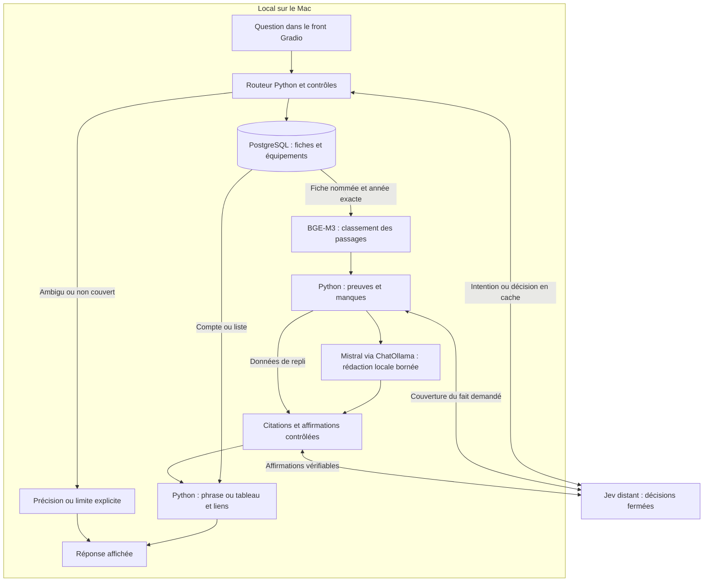

# Architecture actuelle

État relu après le raccordement RAG → Mistral du 14 octobre 2026,
sur le front de validation local 7862. Les anciennes démos restent distinctes.
Cette page décrit les parcours réellement disponibles ; leurs résultats et
limites restent dans les rapports datés.

## Service autonome SQL + RAG — 14 octobre 2026

Le [service commun et sa comparaison](../sql-rag-tools-and-comparison.md)
expose six outils indépendants du fournisseur, avec comptes SQL, recherche
BM25/BGE-M3 et preuves citables. Il a été évalué dans deux passes de huit
modèles distants. Il n'est pas encore raccordé au front Gradio décrit ci-dessous.
Les [corrections après la passe 2](../sql-rag-remaining-failures-20261014.md)
sont vérifiées localement, sans nouvelles réponses des modèles.
La suite est suivie dans l'[issue #4](https://github.com/maax6/bikefinder-rag/issues/4).

## Répartition du travail

Le bot consulte un catalogue local de fiches techniques par marque, modèle,
variante et millésime. **Jev est le seul service d'inférence distant autorisé.**
Il est appelé via OpenRouter pour choisir des décisions bornées. PostgreSQL,
BGE-M3 et Mistral via Ollama restent locaux.

Les acquisitions de sources et les téléchargements initiaux des modèles relèvent
de la préparation du corpus. Le chat utilise les données déjà conservées ; il
n'effectue pas une recherche sur le Web pour chaque question.

| Composant | Responsabilité |
|---|---|
| Gradio / CLI | Recevoir la demande et conserver le contexte de conversation |
| Jev | Choisir des opérations et contrôler la couverture des preuves ou certaines synthèses ; ses décisions peuvent être en cache |
| Code du catalogue | Valider les contraintes, garder les inconnus, restituer les preuves et effectuer les calculs explicites |
| PostgreSQL | Identifier les fiches, appliquer les filtres, produire les comptes et les listes |
| BGE-M3 | Classer les passages des fiches identifiées ; il ne rédige pas de réponse |
| Mistral / Ollama | Rédiger à partir des passages RAG, avec contrôle des affirmations et des citations |
| LangChain / ChatOllama | Transport local pour cette rédaction bornée ; pas de nouvelle recherche ni de service distant |

## Données et préparation

1. Le collecteur Motoplanète conserve les pages, leur état de collecte et les
   fiches structurées dans `data/technical/`. Le collecteur individuel reste la
   référence pour préserver les détails ; le comparateur est une expérience
   conservée, avec ses limites documentées.
2. Les audits et les exports travaillent sur les sources conservées. Les passes
   d'enrichissement utilisent des snapshots figés, séparés de la collecte active.
   Elles classent les preuves d'équipement sans réécrire le texte source.
3. `scripts/load_enriched_catalog.py` importe un snapshot enrichi dans
   PostgreSQL : `technical_fiches`, `technical_equipment`, `technical_passages`.
   Les URL, textes d'origine, identités et empreintes restent disponibles.
4. `catalog/measures.py` construit `technical_measures`, une projection numérique
   conservative avec preuve et empreinte de la source. Une valeur manquante ou
   ambiguë reste inconnue.
5. `technical_embeddings` met en cache les vecteurs BGE-M3 par texte source et
   modèle. Dans la recherche technique existante, les vecteurs manquants peuvent
   être calculés au premier accès à une fiche.

L'ancien corpus Bikez, ses familles de modèles, ses avis et les enrichissements
historiques ont des tables et des scripts distincts. Certains détails Bikez
conservés peuvent compléter une réponse technique si l'identité et le millésime
correspondent exactement ; la source et ses limites sont alors séparément citées.

## Parcours Jev réellement connecté

`agent/loop.py` entre dans `agent/rag_router.py` lorsque
`BIKEFINDER_JEV_ROUTER=1`. Avec `BIKEFINDER_JEV_RAG=1`, le RAG est raccordé aux
lectures de fiches et aux explications acceptées. Les filtres et comptes conservent les
parcours SQL de `agent/jev_router.py`. Le code vérifie les contraintes ; Jev fournit
des choix fermés, sans fabriquer de SQL ni de valeurs techniques.

Avant la lecture d’une fiche, des règles locales distinguent certaines demandes
sur l’état d’un exemplaire, les réparations, l’ergonomie, le ressenti et les effets
du bridage. Elles expliquent les limites du catalogue et demandent les précisions
utiles. Ce sont des réponses déterministes de périmètre, sans appel Mistral ;
elles ne démontrent pas une compréhension générale. Les noms de famille courts
peuvent fournir une liste de variantes à préciser, jamais une identité choisie
automatiquement. Les équipements d’une fiche et leur validité pour un marché
particulier restent deux choses distinctes.

Les comptes, listes, conversions explicites et calculs pris en charge ont leurs
contrôles propres. Les ambiguïtés restent
visibles ; le code ne remplace pas une variante ou une année absente par une
fiche voisine.

**Trois issues possibles à la demande :**

- Un compte ou une liste utilise SQL et un rendu Python. BGE-M3 et Mistral ne
  sont pas utilisés dans ce parcours.
- Une lecture de fiche nommée passe par une identité SQL unique, BGE-M3 local,
  puis Mistral local et des vérifications Jev. Les explications acceptées reçoivent
  ce même dossier RAG. Le code ajoute les sources et les preuves manquantes.
- Une identité ambiguë, une preuve insuffisante ou une rédaction non vérifiable
  donne une clarification ou un repli visible. Une rédaction partiellement
  vérifiée conserve ses affirmations acceptées et complète par les données sources.

Avec `BIKEFINDER_RAG_SYNTHESIS=0`, les passages sont cités sans rédaction.
Lorsque le RAG est désactivé, le parcours Mistral historique reste séparé.

Le raccordement est décrit dans le
[rapport de connexion et de validation A2](../jev-rag-connection-20261013.md).
Il n'établit pas une compréhension générale de toutes les questions moto.
Le [raccordement Mistral et ses essais](../rag-mistral-connection-20261014.md)
décrit la rédaction locale maintenant connectée et les limites observées.

### Exemple observé : Yamaha 2020

Le bouton **« Filtrer · Yamaha, 2020 »** prépare actuellement **« Combien de
Yamaha de 2020 ont l'ABS et un shifter de série ? »**. Le routeur choisit `count`.
La trace utilise une décision Jev déjà en cache ; SQL compte 8 fiches et Python
formate la phrase. Aucun appel BGE-M3 ou Mistral n'intervient.

En demandant **« Liste les Yamaha de 2020 qui ont l'ABS et un shifter de série,
avec les fiches sources »**, le front affiche les huit fiches et leurs liens.
Les passages sources et la sélection SQL ont été vérifiés indépendamment.
Le libellé du bouton ne correspond donc pas à l'opération qu'il prépare.

La génération locale est limitée en temps et en volume. Les citations et un
contrôle Jev conditionnent son acceptation ; en cas d'échec, les faits sources
restent disponibles. Une décision Jev probable ne constitue pas une preuve.

## Recherches disponibles en parallèle

- **Recherche technique** : `catalog/enriched.py::search_technical()` impose une
  fiche unique, modèle et millésime, avant la comparaison des vecteurs normalisés
  BGE-M3 de 1 024 dimensions par distance cosinus. Elle ne fait actuellement ni
  fusion lexicale, ni reranking. Elle est exposée parmi les outils de l'ancienne
  boucle et utilisée dans les expériences de recherche.
- **Recherche d'avis historique** : `agent/tools.py::search_reviews()` combine
  candidats sémantiques et lexicaux, avec reranking local facultatif par
  `bge-reranker-v2-m3`. Les avis portent sur des familles, avec des limites de
  millésime différentes de celles des fiches techniques.
- **POC figé** : les scripts `hybrid_poc_retrieval.py` et associés utilisent leur
  snapshot et leurs index isolés. Leurs mesures ne décrivent pas automatiquement
  le parcours Jev actif.

## Disposition des modules

| Chemin dans `src/bikefinder_rag/` | Rôle |
|---|---|
| `app.py`, `ui.py` | Chat Gradio, état de conversation et présentation |
| `agent/catalog_scope.py` | Limites utiles pour les demandes hors catalogue, règles locales sans génération |
| `agent/jev_router.py`, `query_language.py` | Plan borné, traitement du langage et rendu du catalogue |
| `agent/rag_router.py`, `catalog/technical_rag.py` | Raccordement Jev, identité SQL exacte, BGE local, couverture et citations |
| `agent/rag_synthesis.py` | Rédaction Mistral locale, validation des affirmations et replis sourcés |
| `agent/loop.py`, `tools.py`, `catalog_tools.py` | Entrée commune et boucle historique avec outils |
| `agent/catalog_fast_path.py` | Ancien raccourci déterministe, désactivé quand Jev est activé |
| `catalog/enriched.py` | Import, identité SQL, preuves d'équipement et recherche technique |
| `catalog/measures.py`, `comparisons.py`, `unit_restatements.py` | Projection Motoplanète, calculs et conversions explicitement demandés |
| `catalog/source_*.py`, `supplemental_sources.py`, `category_evidence.py` | Réponses bornées sur preuves source, comptes et compléments conservés |
| `catalog/identity.py`, `measurements.py`, `normalization.py` | Pilote versionné de normalisation des fiches Bikez conservées |
| `embeddings/` | Encodage dense et reranker locaux |
| `db/`, `scraper/`, `eval/` | Accès aux données, collecte et évaluation historique |

`measures.py` et `measurements.py` ont des responsabilités et des sources
distinctes. Les scripts restent dans `scripts/` : imports, tests et commandes de
reproduction dépendent encore de ces chemins. Leur [index](../../scripts/README.md)
permet de distinguer le parcours actuel des expériences.

## Limites et prochain module

Le parcours RAG accepte la lecture des mentions A2 de fiches exactes, avec leurs
limites. Le catalogue ne démontre pas l'homologation d'un exemplaire, les prix actuels, la fiabilité,
le confort ou une autonomie mesurée. Les catégories de conduite générales et
les qualifications de variantes nécessitent également des preuves adaptées.

Le [benchmark de l'issue #3](https://github.com/maax6/bikefinder-rag/issues/3) a été
[exécuté sur les quatre recherches](../technical-retrieval-benchmark-20261013.md).
Le raccordement suivant a validé des identités, citations et limites sur des
questions A2, puis leurs rejeux corrigés. La médiane de 0,82 s concerne ces
réponses factuelles ; elle ne mesure pas la rédaction libre de Mistral.

Le dossier SQL/RAG commun alimente maintenant la rédaction Mistral locale.
Les [essais du 14 octobre](../rag-mistral-connection-20261014.md) séparent
les premiers passages, rejeux corrigés, rédactions et replis. Une évaluation
indépendante reste nécessaire, ainsi qu'une optimisation du temps de rédaction.
Les refus et preuves non vérifiées restent visibles.

Un projet techniquement possible et une brique de récupération validée ne
constituent pas encore un assistant moto général démontré.

Voir le [guide d'évaluation](../guides/evaluation.md), la
[décision hybride historique](../hybrid-workflow-decision.md) et les
[limites des premiers passages et replays](../jev-partial-improvements.md).
