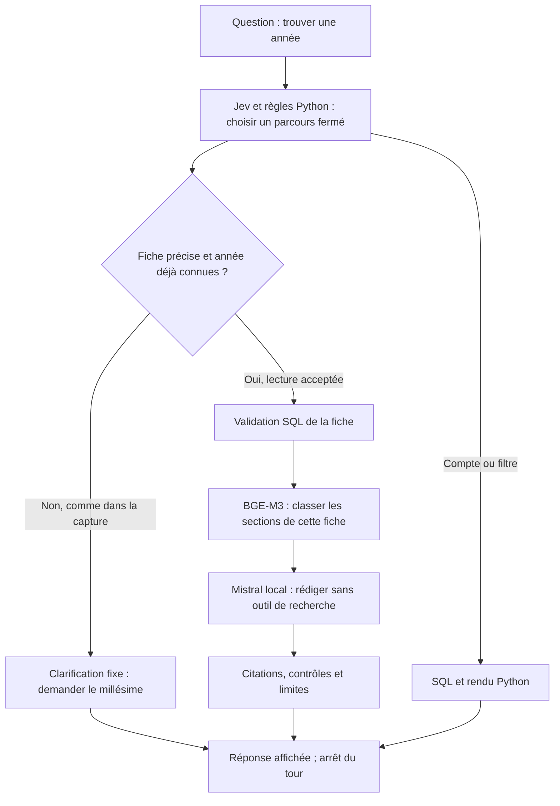
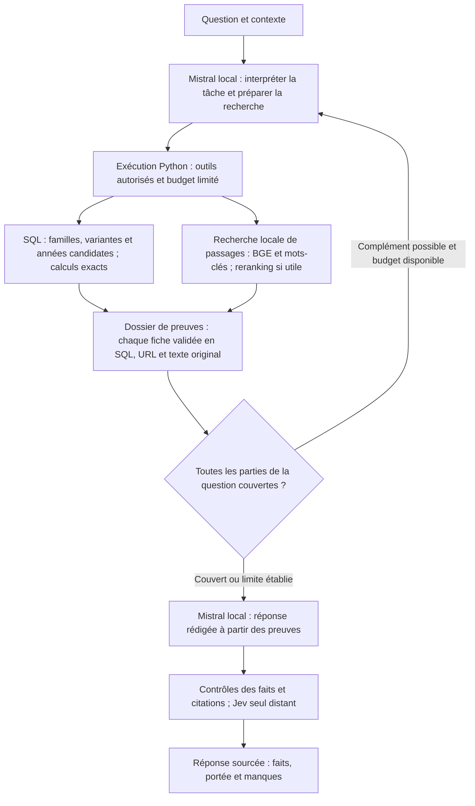

# Audit : le bot doit pouvoir découvrir les informations manquantes

14 octobre 2026. **Diagnostic, sans correction du parcours actif.**

Le front sait lire des fiches déjà désignées et faire rédiger leurs passages par
Mistral local. Il ne constitue pas encore un assistant capable d'organiser une
recherche à travers le catalogue. La question Gold Wing / BMW RT montre cette
différence : l'année recherchée est traitée comme une entrée obligatoire.

## Ce qui a été réellement vérifié

Dans une session Gradio distincte sur `http://127.0.0.1:7862/`, les deux questions
de la capture donnent la même réponse : « Quel millésime souhaites-tu consulter ?
Je ne choisis pas une année à ta place. » Les appels ont pris 0,113 et 0,108 seconde.
Ces durées sont celles d'un blocage, pas d'une réponse rédigée.

Un diagnostic séparé a traversé `run_agent` avec la vraie base en lecture seule.
Les entrées de récupération et de rédaction étaient interceptées afin d'éviter
toute charge de modèle ; aucune n'a été appelée. Le plan retient Honda
`GL 1800 GOLDWING` et `GL 1500 GOLDWING`, mais **aucune BMW RT**. La route est
`clarification`, sans dossier de preuves ni génération. Ce diagnostic n'est pas
présenté comme la trace du même appel Gradio.

Les [observations enregistrées](../eval_results/technical/research-architecture-20261014/observations.json)
conservent les formulations, réponses, plan et exemples sources.

## Fonctionnement actuel

La clarification est écrite dans `agent/jev_router.py:280`. Le changement de
route est à `:738–740`. `agent/rag_router.py:231–258` ne raccorde au RAG que
certains plans acceptés ; `agent/loop.py:336–347` termine le tour dès qu'une
réponse du routeur existe. Le rédacteur de `agent/rag_synthesis.py:54–75` n'a
pas d'outil pour rechercher d'autres preuves.

Ce ne sont donc pas toutes les réponses qui sont écrites à l'avance. Mais les
parcours et de nombreux refus sont fermés avant que Mistral puisse intervenir.

## Trois changements à examiner

| Priorité | Problème | Changement général |
|---|---|---|
| 1 — Recherche d'une demande | Année obligatoire ; famille BMW perdue ; aucun parcours de découverte | Un module de recherche distingue les données fournies et celles à découvrir. Il couvre chaque entité de la demande, avec des recherches locales bornées. |
| 2 — Récupération technique | Le benchmark global et le RAG actif utilisent des implementations différentes | Un module commun de récupération, avec adapters pour catalogue actif et snapshot d'évaluation ; portée précise ou exploratoire explicite. |
| 3 — Preuves et complétude | Une preuve absente du contexte devient un manque, sans nouvelle tentative | Un dossier de preuves distingue ce qui reste à récupérer, ce que le corpus ne contient pas, l'ambiguïté et l'autorité absente. Un complément est possible dans un budget limité. |

Le premier changement est indispensable. La locality doit se situer dans le
module de recherche : une seule correction doit servir « depuis quand »,
« quelles versions », « qu'est-ce qui a changé » et les comparaisons. Son
interface constitue le même seam pour le front et les tests ; ce leverage
évite d'ajouter une exception par question. Il faut remplacer la logique
dispersée, plutôt qu'ajouter un routeur supplémentaire devant elle.

Les modules concernés sont `agent/loop.py`, `jev_router.py`, `query_language.py`,
`rag_router.py`, `rag_synthesis.py`, `catalog/technical_rag.py` et `enriched.py`.
Les projections SQL, sources, empreintes, BGE et contrôles utiles sont conservés.

## Cible proposée — pas encore implémentée

L'exécution doit rester limitée en opérations, candidats et durée. Mistral ne
doit pas fabriquer du SQL libre ni fournir des valeurs de mémoire sans preuve.
Les comptes et calculs restent exécutés en SQL/Python. Jev peut contrôler des
décisions bornées ; son score de confiance ne remplace pas une preuve source.
Le détail du contrat des outils reste à concevoir.

**L'identité exacte demeure obligatoire pour utiliser une preuve.** En revanche,
l'utilisateur n'a pas à fournir l'année quand cette année est précisément ce
qu'il cherche : le catalogue peut la découvrir et l'identifier ensuite en SQL.
Une famille ouverte peut conduire à plusieurs variantes présentées distinctement.

## Ce que notre corpus permet de montrer sur cet exemple

Une sélection SQL exploratoire trouve 64 fiches Honda avec « Gold Wing » dans
le nom et 38 BMW avec le token RT. Cette sélection n'est pas une taxonomie
validée : elle inclut des variantes qu'il faudra distinguer.

La fiche [Honda GL 1800 GOLDWING Tour DCT/Airbag 2018](https://www.motoplanete.com/honda/6859/GL-1800-GOLDWING-Tour-DCTAirbag-2018/contact.html)
conservée dans la base indique une boîte à sept rapports robotisée DCT avec
marche arrière. C'est la première preuve DCT trouvée dans cette sélection.
**Cela établit un millésime documenté, pas une date officielle de lancement,
ni la présence sur toutes les Gold Wing.**

La fiche [BMW R 1300 RT 2025](https://www.motoplanete.com/bmw/11285/R-1300-RT-2025/contact.html)
conservée indique une boîte manuelle à six rapports et un shifter en option.
Aucun passage de ses sections conservées n'évoque ASA ou une automatisation.
Cela ne permet pas de conclure à l'absence d'une version ou option automatique.
Pour répondre à une date de lancement, il faudra une source de portée adaptée,
acquise puis conservée localement ; le chat ne gagne aucun autre service distant.

## BGE-M3, LangChain et validation

BGE-M3 n'a pas été exécuté sur la question bloquée : cet échec ne permet donc
pas de juger ses embeddings. Le [benchmark de recherche](technical-retrieval-benchmark-20261013.md)
montre son utilité dans des fiches correctement identifiées, mais aussi des
erreurs de variante/année en recherche globale. Hybride et reranking existent
dans ce benchmark ; ils ne sont pas raccordés au parcours technique actif.
Une récupération fiable exige aussi de préserver toutes les entités et de
réunir toutes les preuves demandées, au-delà d'un bon premier résultat.

LangChain est déjà utilisé via `ChatOllama` pour le transport du rédacteur.
Il n'organise actuellement aucune recherche. Lui ajouter une orchestration peut
aider l'implementation ; le framework ne résout pas le contrat des outils,
la couverture des données ni la justesse des réponses.

La validation précédente démontre le raccordement du rédacteur sur un petit
panel préparé à partir des fiches et des années. Elle ne démontre pas la
capacité de découverte, ni une fiabilité générale. Le bot doit maintenant être
testé au niveau du parcours complet, avant toute correction des questions du lot.

Critères pour le prochain module :

- Découvrir des millésimes sans les demander comme entrées.
- Traiter chaque famille citée, ou signaler précisément celle non résolue.
- Distinguer premier millésime documenté, disponibilité d'option et lancement.
- Rechercher un complément quand il manque une preuve récupérable.
- Ne pas confondre absence de mention, absence d'équipement et recherche infructueuse.
- Valider chaque citation, variante et année, avec un témoin SQL pour les comptes.
- Mesurer le délai de bout en bout, le temps de recherche et celui de rédaction.
- Réussir plusieurs tâches de découverte nouvelles, puis un lot réservé rédigé
  indépendamment ; une clarification justifiée ne compte pas comme réponse complète.

Le cas Gold Wing / RT est le premier test de diagnostic, pas à lui seul un
benchmark de généralisation. Le front actif reste inchangé et ce cas échoue
toujours : aucune correction n'est revendiquée par cet audit.
